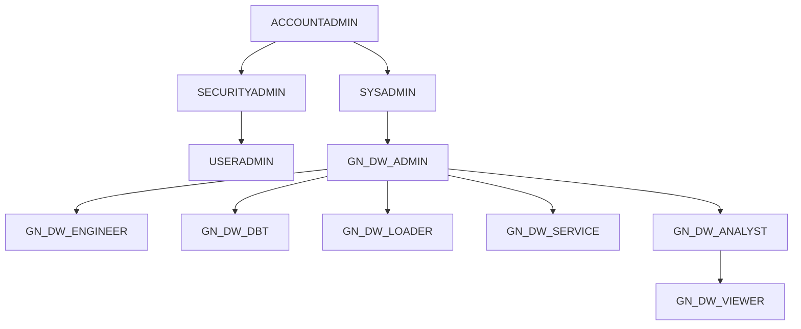

# A0. 환경 실사 baseline

조회는 읽기 전용이며 DDL/DML/GRANT 는 실행하지 않았다.

**[ENV] 분리 규약**(작업계획서 §1-10)을 따른다.
- `[공통]` 절 = GN_DW DB 객체 기준 값. 운영계에서는 같은 쿼리로 **재확인만** 한다.
- `[ENV]` 절 = 계정마다 다른 값. 정본은 `_ENV/<계정>/A0_<Qnn>_<k>.csv` 이고, 아래 표는 그 요약이다.
- 운영계 반영 = `python3 scripts/env_capture.py --id A0 "85_실제 인수인계 문서/10_실무자_인수인계/A0_환경실사_baseline.sql"`
  → `_ENV/<운영계 계정>/` 생성 → 각 표의 `운영계` 열과 `[ENV]` 판정을 채운다.

| 계정 | 구분 | 캡처 시각 | manifest |
|---|---|---|---|
| ZL50263 | 운영 | 2026-10-21 13:16 KST | `_ENV/ZL50263/A0_manifest.csv` (29문장 · OK 29 · ERROR 0) |

## 1. [ENV] 계정 컨텍스트 (Q00 → `A0_Q00_1.csv`)

| 항목 | 운영계(ZL50263) |
|---|---|
| 계정 로케이터 | ZL50263 |
| 계정명 / 조직 | XC97295 / CMRQTUT |
| 리전 | AWS_AP_NORTHEAST_2 |
| 조회 롤 / 사용자 | ACCOUNTADMIN / CHOIH |
| Snowflake 버전 | 10.38.100 |

## 2. [ENV] 데이터베이스 (Q01 → `A0_Q01_1.csv`)

- `[공통]` GN_DW 는 양 계정에 있어야 한다(소유 GN_DW_ADMIN).
- 그 밖의 DB 는 계정 프로비저닝에 따라 다르다.

| DB | 종류 | 운영계(ZL50263) |
|---|---|---|
| GN_DW | STANDARD | 있음 · 소유 GN_DW_ADMIN |
| SANDBOX | STANDARD | 없음 |
| SNOWFLAKE | ACCOUNT | 있음(프로비저닝) |
| SNOWFLAKE_SAMPLE_DATA | IMPORTED | 있음(프로비저닝) |
| USER$&lt;사용자&gt; | PERSONAL | USER$CHOIH 등 |

## 3. [공통] GN_DW 스키마별 객체 수 (Q02 · Q03 → `A0_Q02_1.csv` · `A0_Q03_1.csv` · 운영계 2026-10-21)

| 스키마 | 테이블 | 뷰 | 합계 | 프로시저 | 함수 | 스테이지 |
|---|---|---|---|---|---|---|
| BRONZE_AGENCY | 4 | 0 | 4 | 4 | 0 | 3 |
| BRONZE_BIGQUERY | 1,051 | 0 | 1,051 | 2 | 0 | 1 |
| BRONZE_CRM | 53 | 0 | 53 | 1 | 0 | 1 |
| BRONZE_ERP | 3 | 0 | 3 | 2 | 0 | 2 |
| BRONZE_GA4 | 2 | 0 | 2 | 1 | 0 | 1 |
| BRONZE_GSC | 2 | 0 | 2 | 1 | 0 | 1 |
| DBT_TEST__AUDIT | 0 | 0 | 0 | 0 | 0 | 0 |
| GOLD | 62 | 19 | 81 | 0 | 0 | 0 |
| LAB | 0 | 0 | 0 | 0 | 0 | 1 |
| ML | 42 | 5 | 47 | 23 | 0 | 0 |
| MSTR | 10 | 13 | 23 | 13 | 2 | 0 |
| OPS | 15 | 2 | 17 | 5 | 0 | 3 |
| PUBLIC | 0 | 0 | 0 | 0 | 0 | 0 |
| SECURITY | 0 | 0 | 0 | 0 | 0 | 0 |
| SERVING | 1 | 25 | 26 | 0 | 0 | 0 |
| SILVER | 69 | 0 | 69 | 8 | 0 | 1 |
| **주 스키마 합계(16)** | **1,314** | **64** | **1,378** | **60** | **2** | **14** |
| 백업 사본 6(`BRONZE_CRM_2` 52 · `SILVER_2` 61 · `SILVER_OLD` 57 · `GOLD_2` 46+17 · `GOLD_OLD` 46+14 · `OPS_2` 10+1) | 272 | 32 | 304 | 8(`SILVER_2`) | 0 | 0 |

- 동적 테이블·구체화 뷰는 0건이다.
- BRONZE_BIGQUERY 1,051 = GA4 export 일자 샤드 `events_*` 1,020 · 월 집계 `BQ_*` 30 · `SYNC_ERR_INFO` 1.
- 백업 사본 스키마는 운영 경로가 아니다(이관 전 사본 · 정리 여부는 A8 후보).
- SV(45)·Agent(7)·Cortex Search(1)는 위 표에 포함되지 않는다(§4).

## 4. AI·파이프라인 객체

### 4-1. [공통] GN_DW 정의 객체 (Q04 → `A0_Q04_1~4.csv`)

| 종류 | 건수 | 내역 |
|---|---|---|
| Semantic View | 45 | 전부 GN_DW.SERVING · 소유 GN_DW_ADMIN · 목록 = `A0_Q04_1.csv` |
| Cortex Agent | 7 | 서비스 3 = AGENT_EXECUTIVE · AGENT_MARKETING · AGENT_MEMBER — SERVING · 기본 버전 [ENV] 운영계 = MEMBER VERSION$27 · EXECUTIVE VERSION$20 · MARKETING VERSION$23(2026-10-27 A6 Q07) · 🆕 2026-10-30 O273-B = EXECUTIVE → `VERSION$23` 반영 기록(재캡처 전 TBD(미검증)) · 🟠 그 밖 4 = SERVING `AGENT_MSTR` · `AGENT_OVERALL` · `ASDF` · BRONZE_CRM `AGENT_MSTR_TEST`(서비스 대상 아님 · 정리 후보) |
| Agent SV 배선(spec 실측) | 18 / 31 / 31 → 🆕 2026-10-30 D09 csv = 16 / 32 / 30 | EXECUTIVE / MARKETING / MEMBER · 각 Search 1 · 합집합 45 = SV 전수(미배선 0 · D09) · EXECUTIVE 감소 = O270 W3 |
| Cortex Search | 1 | SERVING.SEARCH_BIZ_DEFINITION · lag 1 day · ACTIVE · 원천 1,002행 · WH GN_DW_ANALYTICS_WH |
| DBT PROJECT | 2 | OPS.DW_PIPELINE · OPS.DW2_PIPELINE · dbt 1.9.4 |

- 🟠 Agent COMMENT 의 「소관 SV 14·25·24종」은 spec 실측(18·31·31)과 다르다 ⇒ COMMENT 가 낡았다(`_드리프트/` DR-03).
  - SV base 분포: GOLD 기반 30종(논리테이블 85) · SERVING 뷰 기반 15종(24) — `B1_Q04_1.csv` · `B1_Q05_1.csv` 실측.

### 4-2. [ENV] 배포·운영 객체 (Q04-5 · Q05 → `A0_Q04_5.csv` · `A0_Q05_1~4.csv`)

Task·Alert·Streamlit 은 GN_DW 안의 객체지만 **배포 상태가 계정마다 다르다**(운영계 설정 상이) ⇒ `[ENV]`.

| 종류 | 운영계(ZL50263) |
|---|---|
| Task (GN_DW) | 9개 (`daily`, `TSK_RUN_MSTR_DAILY`, `AGENCY_*` 등) |
| Alert | 1 · OPS.ALERT_DBT_WARN_SPNSR_CLS_DUP · 매일 09:00 KST · started |
| Streamlit | 11개 (GN_DW.LAB 9개 + USER$CHOIH 2개) |
| Git repository | 1개 (GIT_INTEGRATION 연동) |
| Integration | 8 · EMAIL_ALERT_INTEGRATION(EMAIL) · 외부 접근 5(`GOOGLE_API_ACCESS` · `GOOGLE_BQ_ACCESS_INTEGRATION` · `GOOGLE_GA4_ACCESS` · `GOOGLE_GSC_ACCESS` · `MS_GRAPH_ACCESS`) · `git_integration`(EXTERNAL_API) · SNOWFLAKE$LOCAL_APPLICATION |

## 5. 롤·사용자 (Q06 → `A0_Q06_1~3.csv`)

### 5-1. [ENV] 롤 계층 — 운영계 라이브 기준 · 설계(`07_ENVIRONMENT_RBAC_setup.sql`) 대조는 A2 소관

롤 계층(USAGE 부여 · 부모 → 자식):

### 5-2. [ENV] 롤·사용자 현황

| 항목 | 운영계(ZL50263) |
|---|---|
| GN_DW 롤 7종 실재 | 7/7 (소유 SECURITYADMIN) |
| 롤 계층 | 위 그림과 같음 |
| 사용자 수 | 19명 |
| GN_DW 롤 사용자 할당(`assigned_to_users`) | 각 롤별 사용자 매핑 완료 (A2 매트릭스 참조) |

## 6. [ENV] 웨어하우스·비용 가드 (Q07 → `A0_Q07_1~3.csv`)

| WH | 운영계(ZL50263): 크기 · auto_suspend(s) · 소유 · 용도(COMMENT) |
|---|---|
| COMPUTE_WH | X-Small · 300 · ACCOUNTADMIN · — |
| GN_DW_ANALYTICS_WH | X-Small · 60 · ACCOUNTADMIN · 분석가 쿼리 전용 |
| GN_DW_DEV_WH | X-Small · 60 · ACCOUNTADMIN · 개발 및 테스트 전용 |
| GN_DW_ETL_WH | X-Small · 60 · ACCOUNTADMIN · ETL 및 데이터 적재 전용 (프로시저/태스크) |
| GN_DW_ML_WH | Large · 60 · ACCOUNTADMIN · 머신러닝 전용 |
| SYSTEM$STREAMLIT_NOTEBOOK_WH | X-Small(max 10) · 60 · ACCOUNTADMIN · 시스템 |

| 항목 | 운영계(ZL50263) |
|---|---|
| 리소스 모니터 | 0 (Q07-2) |
| 사용자 생성 예산 | 0 (Q07-3) |
| WH 세대 | 전부 STANDARD_GEN_2 |

## 7. [ENV] 거버넌스 (Q08 → `A0_Q08_1~7.csv`)

| 항목 | 운영계(ZL50263) |
|---|---|
| 마스킹 정책 | 0 (미배포) |
| 행 접근 정책 | 0 |
| 네트워크 정책 | 0 |
| 사용자 정의 태그 | 1 (`GN_DW.SECURITY.AI_COST_SCOPE` · 부착 0 · 계정의 나머지 12건은 SNOWFLAKE 시스템 태그) |
| GN_DW 정책 참조 | 0 (미배포) |
| GN_DW 태그 참조 | 0 |
| GN_DW DMF 부착 | 0 (미배포) |

## 8. [ENV] 드리프트 (설계 스크립트 ↔ 라이브)

| # | 설계 객체 | 정의 파일(80번 기준) | 운영계(ZL50263) |
|---|---|---|---|
| D-A0-1 | TASK GN_DW.OPS.TASK_DBT_DAILY_DEV2 | 06_일배치_모니터링/11_일적재pipeline 구성/03_일배치_TASK_스케줄.sql | 없음 (`GN_DW.OPS."daily"` 정규 운영 task 배포됨) |
| D-A0-2 | TASK GN_DW.MSTR.TSK_RUN_MSTR_DAILY | 03_MSTR_이관/15_MSTR 이관 PoC/snowflake 적용 ddl/07_MSTR_일일적재_TASK.sql | 🟢 배포됨 (`TSK_RUN_MSTR_DAILY` started) |
| D-A0-3 | TASK GN_DW.MSTR.TSK_RUN_MSTR_1ST | 01_실행순서_배포SQL/15_MSTR 이관 PoC/snowflake 적용 ddl/06_MSTR_적재_실행.sql | 1회성 완료 |
| D-A0-4 | RESOURCE MONITOR ML_WH_MONITOR | 06_일배치_모니터링/08_mornitoring/06_웨어하우스비용가드_구축.sql | 🟠 없음 — 비용 가드 미배포 |
| D-A0-5 | TAG GN_DW.SECURITY.WH_COST_SCOPE | 06_웨어하우스비용가드_구축.sql | 🟠 없음 |
| D-A0-6 | TAG GN_DW.SECURITY.AI_COST_SCOPE | 06_일배치_모니터링/08_mornitoring/05_AI비용가드_구축.sql | 🟠 없음 |
| D-A0-7 | STREAMLIT GN_DW.SERVING.* | 01_실행순서_배포SQL/02_GN_DW_building/07_ENVIRONMENT_RBAC_setup.sql | 🟢 9개 Streamlit 앱 배포됨 (LAB 스키마) |
| D-A0-8 | GN_DW 롤 7종 사용자 할당 | 07_ENVIRONMENT_RBAC_setup.sql | 🟢 사용자 19명 할당 완료 |

## 9. [ENV] 후속 단계 영향

| 단계 | 운영계(ZL50263) |
|---|---|
| S3(A3) CoCo 차단 | 🟢 analyst_01 유저 대상 CoCo 한도 0 설정 및 테스트 완료 |
| A6 런북 | 🟢 정규 Task `daily` 및 `TSK_RUN_MSTR_DAILY` 가동 중 |
| N01·N02 정책 SQL | 정책 0건 (설계 DDL 보유, 미배포 상태) |

## 10. [ENV] 데이터 차이 축 · 실행 이력 (Q09 · Q10 → `A0_Q09_1.csv` · `A0_Q10_1~2.csv`)

| 항목 | 운영계(ZL50263) |
|---|---|
| `SILVER.BIGQUERY_REFINED_DATA` 행 / 기간 / 적재일 수 | 327,026,413 / 20240101 - 20261019 / 1,020일 (전체 정규 적재) |
| GN_DW Task 실행 이력 | 22건 (정규 `daily`, `AGENCY_*` 태스크 지속 실행) |
| dbt 실행(최근 30일) | 정기 build 06:01 등 다수 SUCCESS 기록 |

- `BIGQUERY_REFINED_DATA` 는 외부 Python 이 직접 적재한다(dbt source `silver_external`). 운영계와 다른 유일한 데이터 축이므로 GA 계열 SV(SV_GA_*) 수치는 계정마다 다르다.
- 🟢 ADMIN 롤 4회는 build 가 아니라 **배포(ADD VERSION) 때 자동으로 도는 compile** 이다(A6 Q01 실측). build 는 전부 GN_DW_DBT.
  실측 = GOLD 뷰 19개 전부 GN_DW_DBT 소유 · OPS 감사 테이블 11개 DBT 소유 ⇒ 소유 혼입 없음(드리프트 DR-13 해소).
