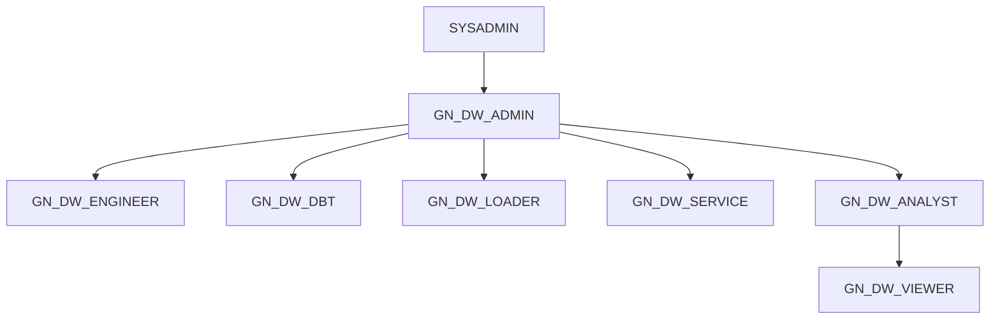

# A2. GNI 롤별 접근권한 매트릭스

**[ENV] 분리 규약**(작업계획서 §1-10)을 따른다.
- `[공통]` = 설계 기준. 정본 = `A2_롤별_접근권한_설계.csv`(80번 배포 SQL 의 활성 GRANT 문을 행으로 옮긴 것).
- `[ENV]` = 라이브 부여와 대조 결과. 정본 = `_ENV/<계정>/` 아래 생성물(손으로 고치지 않는다).

| 파일 | 구분 | 내용 |
|---|---|---|
| `A2_롤별_접근권한_설계.csv` | [공통] | 롤 × 객체종류 × 모드(OBJ·ALL·FUTURE) × 범위 × 권한 × 근거 파일 |
| `A2_롤별_접근권한_근거.sql` | [공통] | 라이브 조회 Q01~Q06(읽기 전용) |
| `_ENV/<계정>/A2_Q*.csv` | [ENV] | `env_capture` 원본 |
| `_ENV/<계정>/A2_매트릭스.csv` | [ENV] | 롤 × 객체종류 × 범위 × 권한 집합 × 객체 수 / 분모 |
| `_ENV/<계정>/A2_설계대조.csv` | [ENV] | 설계 행별 판정 OK · PARTIAL · MISSING · NA |
| `_ENV/<계정>/A2_설계외부여.csv` | [ENV] | 라이브에만 있는 부여(OWNERSHIP 제외) |
| `_ENV/<계정>/A2_롤별_권한매트릭스.xlsx` | [ENV] | 요약(롤×스키마) · 설계대조 · 설계외부여 · 매트릭스 · 롤별 7시트 |

재생성(운영계 포함) 순서:

```
python3 scripts/env_capture.py --id A2 "85_실제 인수인계 문서/10_실무자_인수인계/A2_롤별_접근권한_근거.sql"
python3 scripts/a2_matrix_build.py <CURRENT_ACCOUNT>
```

## 1. [공통] 롤 계층과 역할



| 롤 | 역할(설계 COMMENT · 07 §B) | 기본 WH(07 §C) |
|---|---|---|
| GN_DW_ADMIN | DB·스키마 관리 · DDL · SV/Agent/DBT PROJECT 소유 | DEV · ETL · ANALYTICS |
| GN_DW_ENGINEER | ETL 개발 · 프로시저/태스크 (사람 작업) | ETL · DEV |
| GN_DW_DBT | dbt 실행 전용(DW_PIPELINE) · WIDE 뷰 소유 | ETL |
| GN_DW_LOADER | 외부팀 BRONZE 적재 · 월마감/ML 프로시저 실행 | ETL · ML(USAGE+OPERATE+MODIFY) |
| GN_DW_SERVICE | 서비스 계정(API · Streamlit 앱 소유 예정) | ANALYTICS |
| GN_DW_ANALYST | 분석가 · BRONZE/SILVER/GOLD/ML/MSTR 조회 · Agent 사용 | ANALYTICS |
| GN_DW_VIEWER | 읽기 전용 · GOLD/ML/MSTR + SV/Agent 소비 | ANALYTICS |

- 계층은 단방향이다. ANALYST 는 VIEWER 를 상속하지만 VIEWER 는 ANALYST 의 BRONZE·SILVER 를 받지 않는다(07 §D.4).
- 소유 모델: GN_DW 트리 전체 = GN_DW_ADMIN 소유. 예외 = dbt 가 만드는 GOLD WIDE 뷰·OPS 감사 테이블(GN_DW_DBT 소유 · 08 §D.9 [2]).

## 2. [공통] 롤 × 스키마 설계 범위 (요약)

`S` = 스키마 권한 · `T`/`V` = ALL+FUTURE 테이블/뷰 권한 · `—` = 부여 없음. 상세 권한은 설계 csv.

| 스키마 | ADMIN | ENGINEER | DBT | LOADER | SERVICE | ANALYST | VIEWER |
|---|---|---|---|---|---|---|---|
| BRONZE_CRM·ERP·AGENCY | 소유 | S USAGE · T SELECT | S USAGE · T SELECT | S USAGE · T INSERT/UPDATE · 프로시저 USAGE(CRM) | — | S USAGE · T SELECT | — |
| BRONZE_BIGQUERY | 소유 | S USAGE · T SELECT | — | S USAGE · T INSERT/UPDATE | — | S USAGE · T SELECT | — |
| BRONZE_GA4·GSC | 소유 | S USAGE · T SELECT | S USAGE · T SELECT | S USAGE · T INSERT/UPDATE/DELETE · 프로시저 USAGE | — | S USAGE · T SELECT | — |
| SILVER | 소유 | S USAGE+CREATE · T ALL · V SELECT | S USAGE · T SELECT/INSERT/DELETE/TRUNCATE | S USAGE · 프로시저 USAGE | — | S USAGE · T/V SELECT | — |
| GOLD | 소유 | S USAGE+CREATE VIEW · T DML · V SELECT | S USAGE+CREATE VIEW · T DML · V SELECT | — | S USAGE · T/V SELECT | S USAGE · T/V SELECT | S USAGE · T/V SELECT |
| ML | 소유 | 시뮬레이터 SP USAGE(스키마 USAGE 설계 없음) | — | S USAGE · 프로시저 USAGE · CREATE MODEL/ML.* | S USAGE · T SELECT | S USAGE · T SELECT · 시뮬레이터 SP USAGE | S USAGE · T SELECT |
| MSTR | 소유 | S USAGE+CREATE · T DML · V SELECT · 프로시저/함수 USAGE | — | — | S USAGE · T/V SELECT | S USAGE · T/V SELECT | S USAGE · T/V SELECT |
| SERVING | 소유 | S USAGE · 시뮬레이터 V/SV SELECT | — | — | S USAGE · SV · Agent · Search · V SELECT | S USAGE · SV · Agent · Search · V SELECT | S USAGE · SV · Agent · Search · V SELECT |
| OPS | 소유 | S USAGE+CREATE TABLE · DBT PROJECT USAGE/MONITOR · 알림 SP | S USAGE+CREATE TABLE/TASK · DBT PROJECT USAGE/MONITOR | 🟠 임시: S USAGE · DBT PROJECT USAGE/MONITOR | — | 🟠 S USAGE · ALERT_RECIPIENT_CONFIG SELECT | — |
| DBT_TEST__AUDIT | 소유 | S USAGE+CREATE TABLE | S USAGE+CREATE TABLE | — | — | — | — |
| SECURITY | 소유 | — | — | — | — | — | — |

계정·객체 단위 설계(스키마 밖):
- ADMIN = MANAGE GRANTS · EXECUTE ALERT(계정) · CoWork object MODIFY · EMAIL_ALERT_INTEGRATION USAGE.
- DBT = EXECUTE TASK · EXECUTE MANAGED TASK(계정).
- SV 전부(목록 = `D08_SV요약.csv`) = ANALYST·VIEWER·SERVICE 에 REFERENCES+SELECT 개별 부여(FUTURE 미지원).
- Agent 3종 · Cortex Search 1종 · CoWork object = 소비 3롤 USAGE.

## 3. [ENV] 라이브 대조 결과 (Q01·Q02 → `a2_matrix_build`)

| 항목 | IW20760(개발) | 운영계 |
|---|---|---|
| 설계 대조 행(펼침) | 347 | TBD(미검증) |
| OK | 324 | TBD(미검증) |
| PARTIAL | 2 | TBD(미검증) |
| MISSING | 3 | TBD(미검증) |
| NA(대상 객체 0) | 18 | TBD(미검증) |
| 설계 밖 부여 | 0 | TBD(미검증) |

판정 규칙(생성기 docstring 정본):
- 분모 = 그 스키마·종류에서 7롤 중 하나가 소유한 객체 수. 소유자는 모든 권한 보유로 본다.
- FUTURE 의 `ALL` 은 SELECT/USAGE 존재로 근사한다(비고에 표시).
- 직접 부여만 센다. 롤 상속(ANALYST ← VIEWER 등)과 PUBLIC 상속은 §5 에서 따로 본다.

### 3-1. [ENV] 비OK 판정 해석 (IW20760)

| # | 판정 | 대상 | 해석 | 운영계 |
|---|---|---|---|---|
| D-A2-1 | MISSING ×3 | LOADER → OPS USAGE · DW_PIPELINE USAGE/MONITOR | `04_LOADER_임시권한` 은 「작업 종료 후 회수」 대상이다. 개발계 미부여는 정상일 수 있다. 일배치(D-A0-1)를 LOADER 로 돌릴지 결정 필요 | TBD(미검증) |
| D-A2-2 | PARTIAL ×2 | VIEWER·SERVICE → SERVING 뷰 18/19 | 빠진 1건 = `ML_REALTIME_SIMULATOR_V`(24 :234~236 이 ADMIN·ENGINEER·ANALYST 에만 부여). 🔴 **그런데 그 SV `SV_ML_REALTIME_SIMULATOR` 는 VIEWER·SERVICE 에도 SELECT+REFERENCES 가 있고, Agent 3종 전부에 배선돼 있다**(spec 실측). ⇒ VIEWER·SERVICE 가 Agent 로 시뮬레이터를 물으면 base 뷰 권한 부족으로 실패할 수 있다. 설계 내부 모순 — 🟢 **2026-10-20 결정 = 뷰를 연다(§7 · A8-07)** | TBD(미검증) |
| D-A2-3 | NA ×18 | BRONZE_BIGQUERY 테이블 · SILVER/ML 뷰 · BRONZE_GA4/GSC/CRM·SILVER 프로시저 | 개발계에 대상 객체가 0건이라 판정 불가. FUTURE grant 는 걸려 있어 객체가 생기면 자동 적용된다 | TBD(미검증) |

### 3-2. [공통] 설계 자체의 주의점 (라이브와 무관)

| # | 내용 | 근거 |
|---|---|---|
| D-A2-4 | 🟢 2026-10-20 결정 = **회수**(§7 · A8-08) — ANALYST 에 OPS USAGE + `ALERT_RECIPIENT_CONFIG` SELECT 가 있었다. OPS 스키마 COMMENT「소비 역할에 권한 없음」과 상충(수신자 이메일 노출) | 08_mornitoring/07_OPS_알림 :334·:338 ↔ 07 :167 |
| D-A2-5 | 🟠 ENGINEER 의 GOLD DML·DBT PROJECT USAGE 축소안(08 §D.9 [3])은 주석 상태로 미실행이다 ⇒ dbt 전용 롤 분리 후에도 ENGINEER 가 GOLD 를 쓸 수 있다 | 08 :117~133 |
| D-A2-6 | 🟢 해소 — DBT 롤의 BRONZE_BIGQUERY USAGE 부재는 문제가 아니다. dbt `_sources.yml` 의 `bronze_bigquery` source 는 주석 처리(폐기)됐고 GA 계열 원천은 `silver_external.BIGQUERY_REFINED_DATA`(외부 적재)뿐이다 | 07 :647~662 ↔ `02_dbt_pipeline/10_dbt_pipeline/models/silver/_sources.yml` :21~37 |
| D-A2-7 | 🟡 07 원문 620행에 UTF-8 절단(`반증�`)이 있다 — §D.8 「미검증 1건」 문장이 끊겼다(원본 보존 규칙상 수정하지 않음) | 07 :620 |
| D-A2-8 | 🟢 정정 — 07 §D.5 :453~467 의 「CRM_MEMBER_DEV 가 merge 로 전환 ⇒ SILVER UPDATE 필요」는 낡은 기재다. 현 코드는 SILVER 기본 전략 `append`(dbt_project.yml :221)이고 그 모델은 전략을 덮지 않는다(`unique_key` 만 있음 · append 에서는 무시) ⇒ DBT 롤 SILVER UPDATE 미부여(07 §D.9 [1-b])가 맞다. 08 §D.9 ㉢「SILVER merge 0건」과 일치 | 07 :453~467 ↔ dbt_project.yml :220~222 · `models/silver/crm/CRM_MEMBER_DEV.sql` |

- D-A2-2 의 「실패할 수 있다」 근거 = Cortex Analyst 는 caller 권한으로 SV base 를 실행한다(07 :213 주석). 실호출 검증은 VIEWER 사용자가 없어 운영계 몫이다.

## 4. [ENV] 사용자 할당 (Q06)

| 항목 | IW20760(개발) | 운영계 |
|---|---|---|
| GN_DW 롤을 받은 사용자 | 0 | TBD(미검증) |
| 사용자 할당 전체 | TRIALADMIN ← ACCOUNTADMIN · ORGADMIN | TBD(미검증) |

- 개발계는 롤별 실사용 검증(롤 전환 후 접근 테스트)을 할 수 없다. 운영계에서 롤별 대표 사용자 1명으로 확인한다(A1 §온보딩 점검).

## 5. [ENV] PUBLIC 상속 · Cortex 접근 (Q01-8 · Q05) — A3 선행 정보

| 항목 | IW20760(개발) | 운영계 |
|---|---|---|
| `SNOWFLAKE.CORTEX_USER` 부여처 | PUBLIC · ACCOUNTADMIN · (APPLICATION SNOWFLAKE) | TBD(미검증) |
| `SNOWFLAKE.CORTEX_AGENT_USER` 부여처 | ACCOUNTADMIN · (APPLICATION SNOWFLAKE) | TBD(미검증) |
| `SNOWFLAKE.COPILOT_USER` | PUBLIC | TBD(미검증) |
| PUBLIC 계정 권한 | USE AI FUNCTIONS · EXECUTE AGENT TASK · VIEW LINEAGE 등 5종 | TBD(미검증) |
| PUBLIC 컴퓨트 풀 | SYSTEM_COMPUTE_POOL_CPU · GPU USAGE | TBD(미검증) |

- 모든 GN_DW 롤이 Cortex·Agent 를 **PUBLIC 경유로** 쓴다(07 §D.7-1 설계와 일치).
- ⇒ CoCo 를 롤 단위로 막으려고 CORTEX_USER 를 회수하면 PUBLIC 전체가 막힌다. 이 점이 A3(운영계 연기)의 출발점이다.

## 6. 운영계 반영 시 할 일

1. 위 「재생성 순서」 두 줄을 운영계에서 실행한다.
2. §3·§3-1·§4·§5 의 운영계 열을 `_ENV/<운영계>/A2_설계대조.csv` 등으로 채운다.
3. D-A2-1~3 을 운영계 값으로 다시 판정한다. 설계외부여가 0 이 아니면 행마다 근거 파일을 찾고, 없으면 `_드리프트/` 에 적는다.
4. 설계 csv([공통])는 80번 GRANT 문이 바뀔 때만 고친다. 고친 뒤 `test_a2_matrix_build.py` 를 돌린다.

## 7. 2026-10-20 사용자 결정 반영 (🔴 적용 SQL = `A2_권한조정_적용완료.sql`)

| 결정 | 내용 | 설계 csv | 적용 전 생성기 판정(IW20760) | 적용 후 기대 |
|---|---|---|---|---|
| A8-07 | VIEWER·SERVICE 에 `ML_REALTIME_SIMULATOR_V` SELECT 추가(SV·Agent 배선과 정합) | VIEW ALL SERVING 비고 갱신 | PARTIAL 18/19 × 2 | OK 19/19 |
| A8-08 | ANALYST 의 OPS USAGE · `ALERT_RECIPIENT_CONFIG` SELECT 회수 | ANALYST OPS 2행 삭제 | 설계외부여 2 | 설계외부여 0 |

- A8-08 근거(개발계 실측): OPS 객체를 참조하는 SV·뷰·Agent 0건(`OBJECT_DEPENDENCIES`) · ANALYST 의 OPS 접근 0건(최근 30일 `ACCESS_HISTORY` · 개발계 ANALYST 사용자 0명이라 약한 근거) · 부여 출처(07_OPS_알림 :334·:338)에 사유 없음. 알림 **수신**은 표의 `IS_ANALYST_YN` 플래그로 하며 ANALYST 롤의 표 SELECT 와 무관하다.
- 운영계는 회수 전에 최근 90일 접근 0 을 다시 확인한다(SQL [2] 첫 SELECT).
- 🔴 재실행 함정: 원본 `24_ML_REALTIME_SIMULATOR_DDL.sql` 을 다시 돌리면 A8-07 결정이 원복된다 ⇒ 그 뒤 `A2_권한조정_적용완료.sql` [1] 을 다시 실행한다. 생성기가 PARTIAL 로 다시 잡는다.
- 🟢 A8-08 은 **원본을 고쳤다**(2026-10-20 사용자 지시 「애초에 OPS 권한을 주지 말자」) — `07_OPS_알림수신자관리_및_파이프라인_이메일알림_표준.sql` 의 ANALYST GRANT 2줄을 4개 사본 전부에서 주석 처리했다.
  - 대상 = 워크스페이스 `08_mornitoring/` · 80번 `01_실행순서_배포SQL/08_mornitoring/` · 80번 `06_일배치_모니터링/08_mornitoring/` · `tmp/o216h_snap/`(구판 · 줄 254·258).
  - 판정 = 워크스페이스 전 경로 GRANT 문 전수 검색(56개 경로 · rc=0)에서 활성 ANALYST OPS GRANT 0 · 사본 3개 해시 동일(337fa17c · 3회 재측정).
  - ⇒ 새 계정 구축에서는 ANALYST 에 OPS 권한이 생기지 않는다. 이미 부여된 계정(개발계 IW20760 포함)만 `A2_권한조정_적용완료.sql` [2] 로 회수한다.
- ⚠️ 시뮬레이터 프로시저 `ML.SP_SIMULATE_CAMPAIGN_DVLP` USAGE 는 여전히 ANALYST 만 있다 — 뷰 SELECT 만으로 VIEWER 시뮬레이터 질문이 끝까지 되는지는 운영계 VIEWER 사용자로 확인한다.
