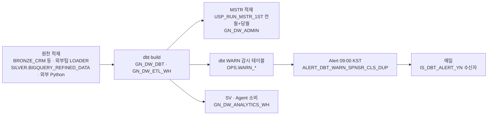

# A6. 일배치 · 장애 대응 런북

**장애가 나면 맨 먼저** 증거를 남긴다:

```
python3 scripts/env_capture.py --id A6 "85_실제 인수인계 문서/10_실무자_인수인계/A6_일배치_장애대응_런북.sql"
```

그다음 §3 유형표에서 증상을 찾는다. 이 문서의 변경 SQL 은 전부 🔴 **미실행 템플릿**이다(dbt 명령은 사람이 실행).

## 1. [공통] 일 단위 흐름 (설계)



- MSTR 프로시저는 dbt 산출물이 아니라 **BRONZE_CRM 을 직접 읽는다**. dbt 뒤에 두는 이유는 GOLD 와 MSTR 가 같은 날 같은 BRONZE 를 보게 하려는 것이다(MSTR 07 :6~7).
- 월마감 `BRONZE_CRM.SP_EXEC_MONTH_END(YYYYMM)`(SILVER 집계 · ML 예측 연쇄 · LOADER 실행)는 dbt build 와 **동시에 돌리지 않는다**(같은 SILVER 를 읽고 쓴다 · 08 §[4]). 🔴 개발계에는 이 프로시저가 없다(이관 범위 밖).

## 2. [ENV] 정기 실행 실체 (Q02 · Q05)

| 대상 | IW20760(개발) | 운영계 |
|---|---|---|
| dbt build | 수동(최근 7일 GN_DW_DBT = build 4 · compile 1 · parse 1 · 전부 SUCCESS + 배포 compile 4 GN_DW_ADMIN) | `GN_DW.OPS."daily"` 06:01 KST · 소유 GN_DW_DBT — MSTR 07 :12 기재 · TBD(미검증) |
| MSTR 일 적재 | 수동 · F_MM_SPNSR_DVLP 202401 - 202610(34개월 · 953,715행) | `GN_DW.MSTR.TSK_RUN_MSTR_DAILY` 고정 07:30 KST — MSTR 07 :11·:16 기재 · RESUME 여부 기록 없음 · TBD(미검증) |
| dbt WARN Alert | `OPS.ALERT_DBT_WARN_SPNSR_CLS_DUP` 매일 09:00 KST · 최근 2회 CONDITION_FALSE | TBD(미검증) |
| 월마감 SP | 없음 | TBD(미검증) |
| dev2 테스트 Task | 없음(`_2` 스키마 없음) | TBD(미검증) |

- 🔴 운영계의 dbt Task 이름이 **소문자 `"daily"`**(인용 식별자)다. `SHOW TASKS` 결과를 그대로 쓰고 대문자로 바꾸지 않는다.
- 🔴 MSTR Task 를 dbt Task 의 `AFTER` 로 걸 수 없었다 — Snowflake DAG 는 predecessor 와 **같은 스키마 · 같은 소유 롤**이어야 한다(MSTR 07 :13~15). 그래서 고정 시각(07:30)이다 ⇒ dbt 가 07:30 을 넘기면 MSTR 가 다른 BRONZE 상태를 읽을 수 있다.

## 3. [공통] 장애 유형별 대응

| # | 증상 | 확인(A6 SQL) | 원인 후보 | 처치 |
|---|---|---|---|---|
| F1 | dbt build ERROR | Q01 `ERROR_MESSAGE` | §7 오류표(A4) — 003001 MODIFY · 002003 권한 · 타입 불일치 | A4 §7 → 수정 후 `ARGS='retry'` 로 실패 지점부터 재개 |
| F2 | build SUCCESS 인데 GA 수치 급감 | Q04 일자 수 불일치 · Q03 `WARN_BIGQUERY_LOAD_GAP` > 0 | 롤링 윈도우(3일) 밖 구멍 · 재배포 후 빈 테이블 | A4 §5 백필(`--vars bigquery_dt_ranges`) → Q03·Q04 재대사 |
| F3 | 데이터 품질 경고 메일 수신 · 실패 저장 테이블에 행 | Q03 — OPS 의 GN_DW_DBT 소유 실패 저장 테이블 전부(현재 11종) | ① `WARN_SPNSR_CLS_AGGR_SRC_DUP` = 외부 수기 업로드 grain 중복 ② `NOT_NULL_*`·`ACCEPTED_VALUES_*` = 원천 코드값 이상(현재 `TD_MS_EVENT_PRTCPNT_DTL.PARTCPT_CHNNL_CD = ')'` 2행 · DR-24) | ① 원천 담당에게 파일 정리·재업로드 요청 · GOLD 는 큰 값 1건으로 계속 서비스(09_OPS :80~82) ② 원천 값 정정 요청 — 정정 전에는 해당 행 라벨이 NULL · 다음 전체 build 후 0행 확인 · 🔴 메일 Alert 는 ① 하나만 감시한다(09 §6 확장 패턴으로 추가 가능) |
| F4 | Alert 가 안 돈다 / 메일이 안 온다 | Q05 Alert 이력 `SQL_ERROR_MESSAGE` | ① 소유 롤에 `EXECUTE ALERT` 없음 ② 07 §4 프로시저를 `CREATE OR REPLACE` 후 GRANT 미복구 ③ 수신자 0(`IS_DBT_ALERT_YN`) | ① 07 §1(ACCOUNTADMIN) ② 07 §6·09 §5 GRANT 재실행 ③ A1 §5-2 |
| F5 | MSTR 적재 실패 | Q06 `BCHLOG` `ERRMSG` · Q05 Task 이력 | 프로시저는 실패를 예외가 아니라 `'ERROR …'` 문자열로 반환 | 원인 수정 후 `CALL GN_DW.MSTR.USP_RUN_MSTR_1ST('<YYYYMM>', 'OPER', FALSE)` 를 해당 월만 · 🔴 `USP_F_MM_SPNSR_DVLP_SUM_INIT`(전체 DELETE)은 호출하지 않는다(MSTR 07 :8~10) |
| F6 | Task 가 SUSPENDED | Q05 `SHOW TASKS` state | `SUSPEND_TASK_AFTER_NUM_FAILURES` 도달 | 원인(F1·F5) 해소 → `EXECUTE TASK` 1회 성공 확인 → `ALTER TASK … RESUME` |
| F7 | Agent 답변 이상(배포 직후) | Q07 버전 목록 | 새 spec 의 규칙·배선 오류 | 직전 버전으로 롤백 `ALTER AGENT … SET DEFAULT_VERSION = 'VERSION$n'` → 원인 수정 후 A5 §3 재배포 |
| F8 | 소비 롤이 SV·뷰를 못 본다 | A2 재생성(`a2_matrix_build`) `설계대조` MISSING | SV·뷰 `CREATE OR REPLACE` 후 GRANT 미복구 | 그 SV/뷰 DDL 파일 끝 GRANT 블록 재실행 |
| F9 | dbt 를 다른 롤로 돌린 뒤 뷰 재생성 실패 | Q08 소유 분포 | GOLD 뷰·OPS 감사 테이블 소유가 GN_DW_DBT 가 아님 | 08 §D.9 [2] 소유권 이관(COPY CURRENT GRANTS) · 이후 DBT 롤로만 실행 |

## 4. [공통] 재처리 원칙

1. **증거 먼저** — `env_capture --id A6` 결과를 남긴 뒤 손댄다.
2. **멱등 경로만 쓴다** — SILVER/GOLD 는 TRUNCATE+append(전량) 또는 창 DELETE+append 라 build 재실행이 안전하다. MSTR 는 월 단위 DELETE 후 재적재라 그 월만 다시 부르면 된다.
3. **`--full-refresh` 는 막혀 있다** — 쓰지 않는다(A4 §2).
4. 월마감 SP 와 dbt build 를 동시에 돌리지 않는다.
5. 재처리 후 Q03(감시 테이블 0행) · Q04(일자 수 일치)를 다시 본다.

## 5. [공통] 정기화 템플릿 (🔴 미실행 · 참고용)

🟢 2026-10-20 결정(A8-09): **개발계는 지금처럼 수동 실행한다** ⇒ 개발계에는 이 템플릿을 쓰지 않는다. 운영계는 기존 `"daily"` Task 가 정본이다(§2). 아래는 새 계정에 정기 build 가 필요할 때만 쓴다. 스냅샷 단계는 넣지 않는다(DEC-61).

```sql
USE ROLE GN_DW_DBT;   -- 소유 = 실행 롤(07 §D.9 · EXECUTE TASK 계정 권한 보유)
CREATE TASK IF NOT EXISTS GN_DW.OPS.TSK_DBT_BUILD_DAILY
  WAREHOUSE = GN_DW_ETL_WH
  SCHEDULE = 'USING CRON 1 6 * * * Asia/Seoul'
  SUSPEND_TASK_AFTER_NUM_FAILURES = 2
  COMMENT = 'DW_PIPELINE 일일 build — A6 §5'
AS
  EXECUTE DBT PROJECT GN_DW.OPS.DW_PIPELINE ARGS='build';
-- 🔴 RESUME 전에 수동 build 1회 + A6 Q03·Q04 통과(02_dbt_parse_compile_build.sql :68~69)
-- ALTER TASK GN_DW.OPS.TSK_DBT_BUILD_DAILY RESUME;
```

## 6. 연락 · 권한 요약

| 작업 | 롤 |
|---|---|
| dbt build·retry·백필 | GN_DW_DBT |
| dbt 재배포 · Agent 버전업 · SV 재배포 · MSTR CALL · Alert 관리 | GN_DW_ADMIN |
| 월마감 SP | GN_DW_LOADER |
| EXECUTE ALERT · EXECUTE TASK 계정 권한 · 알림 통합 | ACCOUNTADMIN |
| 장애 메일 수신자 | `OPS.ALERT_RECIPIENT_CONFIG` — 🔴 개발계 PIPELINE_ADMIN 수신자 0(A1 §5-3) |
| 에스컬레이션 | RUNBOOK §9: L1 ENGINEER 15분(dbt·모델) → L2 ADMIN 30분(권한·DDL·WH·보안) → L3 ACCOUNTADMIN+Support 1시간 · 외부 LOADER 팀(BRONZE) · 🔴 담당자·연락처는 원문도 템플릿(미기입) ⇒ owner TBD |

## 7. [공통] 기존 RUNBOOK(06_RUNBOOK.md · 2026-07-22) 대조

이 문서가 RUNBOOK 을 대체하지는 않는다. 아래 절차는 RUNBOOK 에 있고 지금도 유효하다. 실측과 어긋나는 기재는 오른쪽 열을 따른다.

| RUNBOOK 절 | 계속 유효한 내용 | 실측과 다른 기재 → 따를 값 |
|---|---|---|
| §3.3 GOLD/SILVER 컬럼 변경 | ① 물리에 `ALTER`(🔴 `CREATE OR REPLACE` 금지 — FK·GRANT·데이터 파괴 · 2026-08-03 ERROR 3·SKIP 68 사고) ② 같은 세션에 정본 DDL(`06_DDL.sql`·`08_SILVER_테이블DDL`)도 수정 ③ 모델 산출 컬럼 맞춤 ④ build ⑤ 정본↔물리 컬럼 양방향 대조 | 실행 롤 `GN_DW_ENGINEER` → **GN_DW_DBT**(A4 · DR-19) · 신규 SILVER 테이블은 `CREATE TABLE IF NOT EXISTS` 블록으로 추가(예: `CRM_HOLIDAY` · DR-25) |
| §6.2 롤별 권한 점검 | 🔴 **`USE SECONDARY ROLES NONE` 을 먼저** 실행한다 — 안 하면 보유 롤 합집합으로 평가돼 차단돼야 할 것이 통과한다(실제 오탐). `CURRENT_SECONDARY_ROLES()` 가 빈 값인지 확인 · 끝나면 `ALL` 로 복원 | Agent 이름 `AGENT_OVERALL` → 현행 `AGENT_EXECUTIVE`·`AGENT_MARKETING`·`AGENT_MEMBER`(Q07) |
| §4.1 BRONZE 이상 | 24시간 미갱신·행수 50% 급감 → LOADER 팀 · 스키마 변경 → BRONZE DDL → SILVER 모델 | 신선도 = Q09. 🟠 개발계 실측 HOURS_STALE 87(마지막 2026-10-16 05:01 · 개발계는 수동 적재라 정상 범위) · 운영계 TBD |
| §4.2 BRONZE 중복 제거 | 키 기준 `ROW_NUMBER` 로 최신 1행 | 🔴 **원문 SQL 그대로 실행 금지(DR-26)** — ENGINEER 는 BRONZE_CRM 에 USAGE 만 있어 실패하고(Q10), ADMIN 으로 돌려도 `COPY GRANTS` 가 없어 LOADER·DBT·ANALYST grant 가 사라진다. 실행 전 Q09 로 `N = N_KEY` 를 확인한다(개발계 1,623,329 = 1,623,329 · 중복 0). 필요하면 GN_DW_ADMIN · `CREATE OR REPLACE TABLE … COPY GRANTS AS …` 로 쓰고, 그 전에 LOADER 팀에 원천 재적재를 먼저 요청한다 |
| §5 RM 트리거 | — | RM 미배포(A0 · 정책/RM 0) ⇒ 해당 없음 · 비용 이상은 RUNBOOK §5.3 쿼리(QUERY_HISTORY TOP 10)를 그대로 쓴다 |
| §8 보안 사고 | §8.2 로그인 실패 · §8.3 GRANT/REVOKE 감사 · §8.4 대량 추출 쿼리 — 그대로 유효(ACCOUNT_USAGE) | §8.1 `ALTER ACCOUNT UNSET NETWORK_POLICY` — 개발계는 네트워크 정책 0(`SHOW NETWORK POLICIES` 2026-10-20 실측) · 운영계 TBD |
| §11 전체 재구축 | 순서 0 RBAC → ① GOLD DDL → ② SILVER DDL → ③ DBT PROJECT → ④ build → ⑤ 08 After Deploy → ⑥ SV → ⑦ 09_1 → ⑧ 09_2(🔴 빠뜨리면 Agent 가 도구 0개) · 🔴 ①② 는 데이터 파괴라 신규 계정만 | 수치(SILVER 38·GOLD 28·SV 8·Agent 2)는 stale → 현행 = A0(SV 40 · Agent 3) · 정본 순서 = `01_실행순서_배포SQL/문서실행순서.md`(D02 §8) |
| §1.1·§1.2 일상 점검 기대값 | — | 「65 models」·「BRONZE 48 / SILVER 32 / GOLD 24」·「SV 5」 = 2026-07-22 값으로 **stale** ⇒ A7 정기점검 체크리스트의 현행값을 쓴다 |
