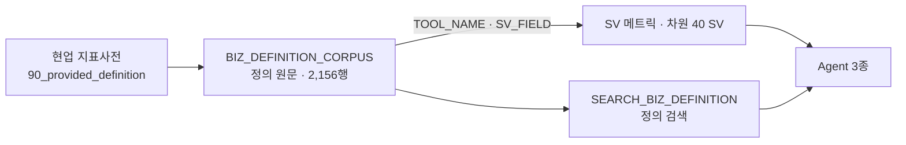

# D01. 요구사항 · 지표 정의서 (통합)

본문 = `D01_지표매핑.csv`(237행 · 지표 → 정의 · 산식 · 적용 Agent · 답하는 도구 · SV 필드 · 대응 상태 · 원천 파일:행).

- 지표의 **정의·산식 원문**은 현업 지표사전이 정본이다. 이 문서는 그것을 「DW 에서 어떻게 답하는가(도구·SV 필드)」와 한 줄로 잇는다.
- 코퍼스는 원천 셀을 요약·가필하지 않는다. 도구·SV 필드·대응 상태는 오버레이 csv(O237)로만 덧붙였다(생성기 규칙).

## 1. 지표 원천 구성 (실측)

| 원천 묶음(DOC_ID 접두) | 지표 | 내용 |
|---|---|---|
| `MET_CMN` | 176 | 공통 지표(공통지표_flat · 07_추가 공통) |
| `MET_NEW` | 57 | 신규 지표(신규지표 · 07_추가 신규) |
| `RT` | 4 | 라우팅 결정에서 지표로 등재된 행 |
| 합계 | 237 | |

**원문 ↔ 코퍼스 건수 대조 (2026-10-20 · 원문 전량 읽음)**

| 묶음 | 원문 | 코퍼스 | 차이 |
|---|---|---|---|
| 공통 | 02 = 162 + 07 §1 = 16 ⇒ 178 | 176(`MET_CMN-1`~`-178` 중 `-15`·`-16` 없음) | 🟠 −2 = 02 #15 「국내/해외 구분」 · #16 「사업/사례 구분」 — 코퍼스 결함이 아니라 **입력 csv(`공통지표_flat_20261003.csv`) 에 처음부터 없다**. 두 항목은 신규 #56·#57(캠페인유형 국내/해외 · 사업/사례)과 4번째 값이 달라(「전체」↔「전체사업」 · 「통합」↔「기타」) 현업 확인 요청 중이었다(`20_issue/20_현업확인_요청_조각/20_현업확인_요청-006.md` :54~55). 빠진 경위 기록은 찾지 못했다(DR-27) |
| 신규 | 03 = 53 + 07 §2 = 4 ⇒ 57 | 57 | 0 |

- 정의·산식 원문을 인용할 때는 02·03·07 원문을 정본으로 쓴다. 코퍼스는 셀을 무가공으로 옮긴 사본이다.
- `00_README.md` :33~35 의 「설계 기준 215(= 02·03)」는 07 추가분 20 을 아직 분모에 넣지 않은 값이다(README 자체 경고). 이 문서는 코퍼스 실측 237 을 쓴다.

- 같은 코퍼스에 용어 517 · 조직 222 · 라우팅 26 · 원천참고 1,154 행이 함께 있다(Cortex Search 원천 · A5 §5).

## 2. 대응 상태 (COVERAGE · 지표 237)

| 상태 | 뜻(26 SQL COMMENT 는 C1~C5 = 「답변 가능」 · G1·G2 만 정의 ⇒ C1~C5 세부 뜻은 코드명 기준 해석) | 지표 | 도구 배선 |
|---|---|---|---|
| C1_METRIC | SV 메트릭 1개로 바로 답한다 | 60 | 60 |
| C2_COMBINE | 메트릭 여러 개를 조합한다 | 16 | 16 |
| C3_CROSS | 여러 SV 를 교차한다 | 6 | 6 |
| C4_DIMENSION | 차원·필터로 분해해 답한다 | 21 | 21 |
| C5_PARTIAL | 부분적으로 답한다(근사·범위 제한) | 32 | 32 |
| G2_NEED_CONFIRM | 산식 원문 확인 필요 | 3 | 3 |
| G1_NEED_MODEL | 현재 산출 불가(모델 추가 예정) | 0 | — |
| (산식 미등록) | 원천 지표사전에 산식이 없다 | 99 | 0 |

- 🟢 산식이 등록된 지표 138 은 전부 답하는 도구가 지정돼 있다(배선 138/138).
- 🟠 산식 미등록 99 는 도구 배선이 없다. 이들은 「미구현」이 아니라 「정의가 아직 수치 산식으로 확정되지 않은 지표」다 ⇒ Agent 는 계산 전에 가정을 제시하고 묻는다(D09 §3 「미정의 지표」 규칙).
- 🟠 G2 3건은 산식 원문이 모호해 현업 확인이 필요하다 ⇒ `D01_지표매핑.csv` 에서 `COVERAGE = G2_NEED_CONFIRM` 행을 현업에 회신 요청한다.

## 3. 요구사항 → 구현 추적

- 지표 하나를 추적하는 법: `D01_지표매핑.csv` 의 `TOOL_NAME`(Agent 도구) → `D09_Agent도구.csv` 의 대상 SV → `SV_FIELD`(논리테이블.필드) → `D08_SV메트릭.csv` 의 식 → `D06_테이블계보.csv` 의 GOLD·SILVER·BRONZE.
- 한 행에서 끝까지 잇는 통합 사전은 N03(트랙 B S6)에서 만든다.

## 4. 운영 규칙

- 지표 정의 변경 = 원천 지표사전 수정 → 코퍼스 재생성(`build_biz_definition_corpus.py` · A5 §5) → 필요하면 SV·Agent 수정. 코퍼스 테이블을 직접 고치지 않는다.
- 비가산 지표 = 원천 문구에 「비가산」이 있으면 `IS_ADDITIVE = N`(코퍼스 규칙). Agent 는 그런 지표를 하위 값 합산으로 만들지 않는다.

## 5. 드리프트

| # | 문서 기재 | 실측 | 처리 |
|---|---|---|---|
| DR-22 | 26 SQL :5「2,145행」 · [7] 라우팅 16 · 지표 236 · COVERAGE G1 5 | 2,156행 · 라우팅 26 · 지표 237 · G1 0(C1 +1 · C4 +2 · C5 +2) | 기록만 — 판정은 등식(산식 146 = COVERAGE 146)으로 |
