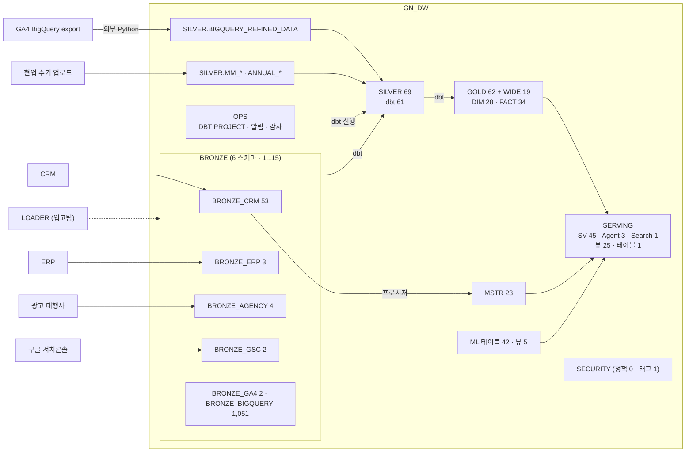
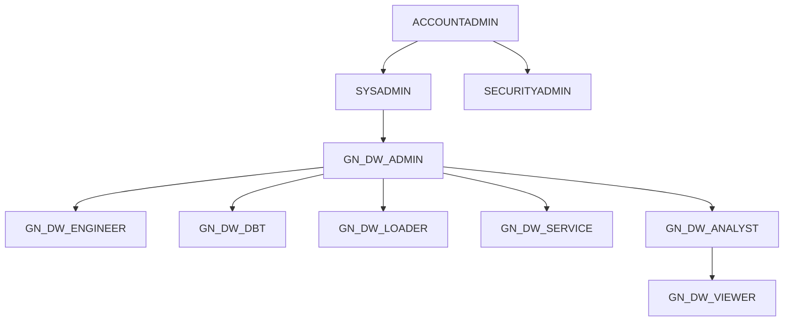
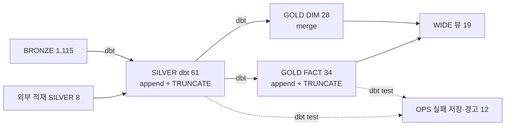
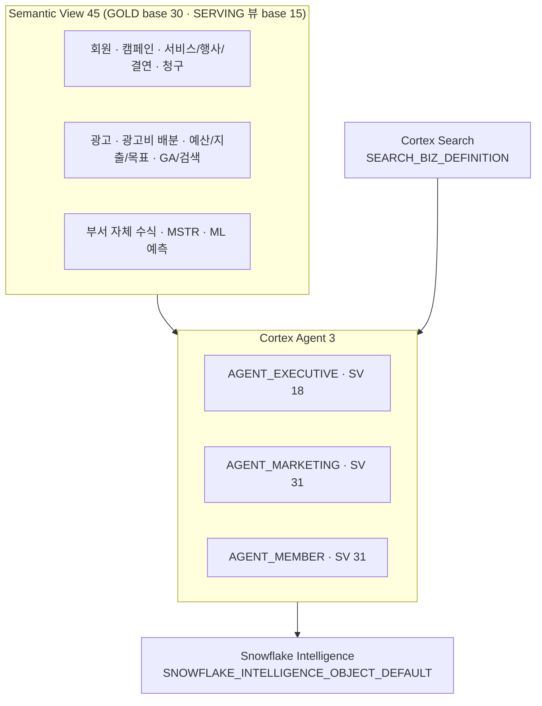

# D02. GN_DW 아키텍처 정의서

원본(2026-07-22)의 9개 장 구조를 유지하고 숫자·객체명을 운영계(ZL50263) 2026-10-21 실측으로 바꿨다. 바뀐 부분은 §10 에 모았다.

## 1. 데이터 흐름

- 계층 참조: **SERVING → GOLD → SILVER → BRONZE 단방향**(P2). 예외 = MSTR 프로시저(BRONZE_CRM 직접) · ML 프로시저 결과 · 🟠 `GOLD.DIM_DATE` 의 `BRONZE_CRM.TM_CM_SCHDUL_MNG` 직접 참조 1건(DR-25 · `SILVER.CRM_HOLIDAY` 경유로 코드 수정 완료 · 🔴 운영계에 `SILVER.CRM_HOLIDAY` 없음(B1 Q01 · 2026-10-21) ⇒ 체크리스트 ⑤-3·4 미배포).
- ETL = dbt 프로젝트 `GN_DW.OPS.DW_PIPELINE`(140 models = SILVER 61 + GOLD 79) + MSTR 프로시저 + 외부 적재(D07).

## 2. 계층별 역할

| 계층 | 스키마 | 객체(운영계 ZL50263 실측 · 🆕 2026-10-27 = 계층 테이블·뷰 수(N08 Q01) · GOLD 분류(B1) · Streamlit(D10 Q07) · 괄호 안 세부·프로시저 수는 2026-10-21) | 핵심 원칙 |
|---|---|---|---|
| 적재 | BRONZE_CRM · AGENCY · ERP · GA4 · GSC · BIGQUERY | 테이블 1,122(10-21 = 1,115 · 세부는 10-21: BIGQUERY 1,051 = GA4 export 일자 샤드 `events_*` 1,020 · 월 집계 `BQ_*` 30 · `SYNC_ERR_INFO` 1) · 적재 프로시저 10 · Task 7 | 원천별 분리 · 원천 1:1 |
| 통합·정제 | SILVER | 테이블 76 · 뷰 1(10-21 = 69 = dbt 61 + 외부 적재·매핑 8) · 프로시저 8 | 타입·NULL·코드 라벨 · 행 grain 유지 · TRUNCATE+append |
| 분석 | GOLD | DIM 29 · FACT 34 · seed 1(`ORG_SUCCESSION_MANUAL`) · WIDE 뷰 19 · FK 71 | SILVER 만 참조 · star schema |
| 예측 | ML | 테이블 39 · 뷰 5 · 프로시저 23 | 데이터셋 적재·예측 프로시저 · 결과 테이블 |
| MSTR 이관 | MSTR | 테이블 10 · 뷰 13 · 프로시저 13 · 함수 2 | 원 MSTR 리포트 정의 유지 |
| 소비 | SERVING | SV 45 · 서비스 Agent 3 · Search 1 · 뷰 25 · 테이블 1(코퍼스) | SV·Agent 는 SERVING 에만(P7) |
| 운영 | OPS | DBT PROJECT 2(`DW_PIPELINE` · `DW2_PIPELINE`) · 프로시저 5 · Alert 1 · 테이블 15 · 뷰 2 · 스테이지 3 | 배포·알림·dbt 감사 |
| 거버넌스 | SECURITY | 정책 0 · 태그 1(`AI_COST_SCOPE`) | 정책 격리(MANAGED ACCESS) |
| 백업 사본 | `BRONZE_CRM_2` · `SILVER_2` · `SILVER_OLD` · `GOLD_2` · `GOLD_OLD` · `OPS_2` | 테이블 272 · 뷰 32 | 운영 경로 아님(이관 전 사본) |
| 실험 | LAB | Streamlit 12 | 운영 경로 아님 |

- 근거 = `_ENV/ZL50263/A0_Q02_1.csv` · `A0_Q03_1.csv` · `A0_Q04_*.csv` · `B1_Q01_1.csv` · `B1_Q04_1.csv`.
- 🟠 SERVING 에는 서비스 Agent 3 외에 `AGENT_MSTR` · `AGENT_OVERALL` · `ASDF` 가 있고 `BRONZE_CRM.AGENT_MSTR_TEST` 1 이 더 있다(정리 대상 · A8 후보).

## 3. RBAC 역할 계층

| 롤 | BRONZE_* | SILVER | GOLD | SERVING | OPS | SECURITY |
|---|---|---|---|---|---|---|
| ADMIN | 소유 | 소유 | 소유 | 소유 | 소유 | 소유 |
| ENGINEER | SELECT | 개발+DML | DML+뷰 생성 | 일부 | dbt 프로젝트·알림 | — |
| DBT | SELECT(BIGQUERY 제외) | DML | DML+뷰 생성 | — | 감사 테이블·Task 생성 | — |
| ANALYST | SELECT | SELECT | SELECT | SV·Agent·Search·뷰 | — (2026-10-20 결정) | — |
| VIEWER | — | — | SELECT | SV·Agent·Search·뷰 | — | — |
| LOADER | INSERT·UPDATE(+DELETE GA4·GSC) | 프로시저 | — | — | (임시) | — |
| SERVICE | — | — | SELECT | SV·Agent·Search·뷰 | — | — |

- 롤 7종(원본 6종 + 2026-09 GN_DW_DBT). 상세 = D03.
- 🔴 owner's rights 예외: Streamlit·소유자 권한 객체는 소유 롤 권한으로 돈다 ⇒ 앱 소유 = GN_DW_SERVICE · 연결 = caller's rights.

## 4. 웨어하우스 분리

| WH | 크기 · 자동중단 | 워크로드 | 롤 |
|---|---|---|---|
| GN_DW_ETL_WH | X-Small · 60s | dbt · 적재 · MSTR · Alert | ENGINEER · LOADER · DBT · ADMIN |
| GN_DW_ANALYTICS_WH | X-Small · 60s | 분석 · SV/Agent · Search | ANALYST · VIEWER · SERVICE |
| GN_DW_DEV_WH | X-Small · 60s | 개발 · DDL · 배포 | ADMIN · ENGINEER |
| GN_DW_ML_WH | Large · 60s | ML 프로시저 | LOADER |

- 원본 3종 + ML_WH(2026-10). 값 = 운영계 실측(A0 Q07 · 2026-10-21 · 전부 Gen2 · 소유 ACCOUNTADMIN).

## 5. ETL 파이프라인

- 실행 = `EXECUTE DBT PROJECT GN_DW.OPS.DW_PIPELINE ARGS='build'`(롤 GN_DW_DBT). 정기 스케줄 = 운영계 `OPS."daily"` Task 06:01 KST · started(N04 Q01 · 2026-10-21).
- 스냅샷 영구 미가동(DEC-61) · BIGQUERY 계열 롤링 창 증분(3일) · 상세 = D07.

## 6. SERVING 계층 (AI)

- 정확도 장치: SV 동의어·COMMENT(메트릭 395 · 2026-10-27) · VQR 43(26 SV) · Agent 지침(형식·수치 근거·NGO 표현) · 비즈니스 정의 Search(원천 1,002행) · 평가셋(`EVAL_O224_*`).
- 운영계 실측 = `B1_Q04_1.csv` · `B1_Q11_1.csv` · `A0_Q04_3.csv` · D09(Agent 도구) · SV 목록 = `D08_SV요약.csv`.
- 상세 = D08(SV) · D09(Agent).

## 7. 보안 · 거버넌스

| 항목 | 운영계 실측(2026-10-21) | 계획 |
|---|---|---|
| 네트워크·마스킹·행 접근 정책 | 0 · 부착 0 | N02 설계(🔴 운영계 미적용) |
| 데이터 품질(DMF) | 0 · dbt 테스트로 대체 운영(실패 저장·경고 12) | N01 설계(🔴 운영계 미적용) |
| 비용 가드(리소스 모니터·quota·태그) | 리소스 모니터 0 · 사용자 생성 예산 0 · 태그 `AI_COST_SCOPE` 정의만(부착 0) | A8-11 결정 대기 |
| 알림 | Alert 1(dbt 경고 · started) · 수신자 표 9행 · 공통 발송 프로시저 | 수신자 1 지정됨 · 🔴 `"daily"` Task 실패 알림 경로 없음(A8-10 · 10-27 R92) |
| CoCo 사용 통제 | 테스트 사용자 `ANALYST_01` 한도 0 적용 · 나머지 계정 기본 | A3 |

## 8. 구축 실행 흐름

| 단계 | 내용 |
|---|---|
| 1 | WH 4 · 롤 7 + 계층 · DB + 스키마 |
| 2 | 알림 수신자·OPS 객체 |
| 3 | SILVER·GOLD DDL · 매핑 적재 |
| 4 | MSTR 스키마·객체·적재 |
| 5 | dbt 배포 → After_Deploy GRANT → build |
| 6 | dbt 경고 Alert |
| 7 | SV 45 · ML 뷰 · 코퍼스·Search |
| 8 | Agent 3 생성 → 버전업 |
| 9 | 정책·비용 가드·정기 Task |

- 정본 실행 순서 = `01_실행순서_배포SQL/문서실행순서.md`(신규 51단계 + 기존 환경 갱신 19단계).

## 9. 핵심 설계 원칙

| ID | 원칙 | 실측 확인 |
|---|---|---|
| P1 | 계층 분리 BRONZE → SILVER → GOLD → SERVING | D06 계보 |
| P2 | GOLD 는 BRONZE 직접 참조 금지 | 🟠 예외 1 — `GOLD.DIM_DATE` 가 `source('…', 'TM_CM_SCHDUL_MNG')` 로 `BRONZE_CRM` 을 직접 읽는다(DR-25 · 2026-10-20 사용자 결정으로 `SILVER.CRM_HOLIDAY` 삽입 · 코드 수정 완료 · 🔴 운영계 미배포). 나머지 GOLD source 4 는 SILVER 외부 적재 테이블 · dbt source 76 = SILVER 모델 71 + GOLD 모델 5 |
| P3 | 소비는 SERVING SV/Agent 경유 · GOLD 직접은 SELECT 한정 | D03 |
| P4 | 커스텀 롤 → SYSADMIN 귀속 | A0 Q06 |
| P5 | 워크로드별 WH 분리 | §4 |
| P6 | 멱등(TRUNCATE+append · 창 DELETE · full_refresh 차단) | dbt_project.yml |
| P7 | SV·Agent 는 SERVING 에만 | SV 45 전부 SERVING · 🟠 Agent 1(`BRONZE_CRM.AGENT_MSTR_TEST`) 예외 |

## 10. 원본(2026-07-22) 대비 변경

| 항목 | 원본 | 운영계 실측(2026-10-21) |
|---|---|---|
| BRONZE | 4 스키마 · 48 | 6 스키마 · 1,115(BIGQUERY 샤드 1,051 포함) |
| SILVER | 32 | 69(dbt 61) |
| GOLD | star 24(15 DIM + 9 FACT) + WIDE 9 | 62(28 DIM + 34 FACT) + WIDE 19 |
| dbt models | 65 | 140 |
| SV / Agent | 5 / 2(AGENT_MEMBER · AGENT_OVERALL) | 45 / 서비스 3(EXECUTIVE · MARKETING · MEMBER) · `AGENT_OVERALL` 은 남아 있으나 서비스 대상 아님 |
| 롤 / WH | 6 / 3 | 7(+DBT) / 4(+ML) |
| 신규 스키마 | — | ML · MSTR · DBT_TEST__AUDIT · LAB · 백업 사본 6 |
| 보안 정책 | 설계안(NR_* · NP_GN_DW · 마스킹) | 미배포(0) |
