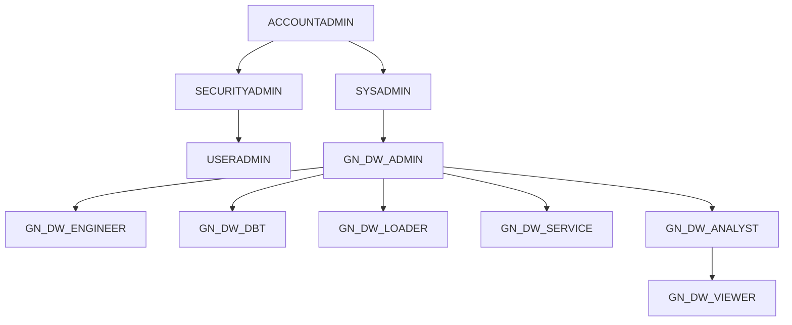

# D03. 환경 구성서 + RBAC 권한 매트릭스

## 1. 환경 개요

| 항목 | 값 | 비고 |
|---|---|---|
| 데이터베이스 | `GN_DW` (소유 GN_DW_ADMIN) | 스키마 15 · 테이블 240 · 뷰 52 (A0 §3) |
| 레이어 | BRONZE(원천 6 스키마) → SILVER → GOLD → SERVING(SV·Agent·Search) | ML · MSTR · OPS · SECURITY · DBT_TEST__AUDIT 보조 |
| 계정 | 운영 = ZL50263(AWS_AP_NORTHEAST_2) | 계정 의존 값은 `[ENV]` 규약으로 계정별 재캡처 |
| 정책 | 마스킹·행 접근·네트워크 정책 0 · 사용자 정의 태그 0 · DMF 0(실사 시점) → 🟢 2026-10-20 마스킹 1(BRONZE 12 컬럼) · DMF N01 적용 · A2 권한 조정 2건 적용 | 신규 설계 = N01·N02 |

## 2. 웨어하우스

| WH | 크기 | auto_suspend(s) | 용도 | 사용 롤 |
|---|---|---|---|---|
| GN_DW_ETL_WH | Small | 60 | 적재·프로시저·태스크·dbt | ADMIN · ENGINEER · LOADER · DBT |
| GN_DW_DEV_WH | X-Small | 60 | 개발·테스트 | ADMIN · ENGINEER |
| GN_DW_ANALYTICS_WH | Medium | 300 | 분석 · SV/Agent 소비 · Search | ADMIN · ANALYST · VIEWER · SERVICE |
| GN_DW_ML_WH | Small | 60 | ML 프로시저(실행 중 크기 조정) | LOADER(USAGE+OPERATE+MODIFY) |

- 크기·auto_suspend 는 계정마다 다르다([ENV] · 운영계 값 = N06 §2-2). 리소스 모니터는 미배포다(D11 · A8-11).

## 3. 롤 계층

| 롤 | 역할 |
|---|---|
| GN_DW_ADMIN | DB·스키마·SV·Agent·DBT PROJECT 소유 · DDL · 배포 |
| GN_DW_ENGINEER | ETL 개발(사람) |
| GN_DW_DBT | dbt 실행 전용 · GOLD WIDE 뷰·OPS 감사 테이블 소유 |
| GN_DW_LOADER | 외부팀 BRONZE 적재 · 월마감/ML 프로시저 실행 |
| GN_DW_SERVICE | 서비스 계정(API · Streamlit 앱 소유 예정) |
| GN_DW_ANALYST | 분석가 · 원천(BRONZE)~SERVING 조회 · Agent 사용 |
| GN_DW_VIEWER | 현업 조회 · GOLD/ML/MSTR + SV/Agent 소비 |

## 4. 권한 매트릭스 (요약)

| 스키마 | ADMIN | ENGINEER | DBT | LOADER | SERVICE | ANALYST | VIEWER |
|---|---|---|---|---|---|---|---|
| BRONZE_* (6) | 소유 | 읽기 | 읽기(BIGQUERY 제외) | 쓰기(INSERT/UPDATE · GA4·GSC 는 DELETE) | — | 읽기 | — |
| SILVER | 소유 | 개발+DML | DML(UPDATE 제외) | 프로시저 실행 | — | 읽기 | — |
| GOLD | 소유 | DML+뷰 생성 | DML+뷰 생성 | — | 읽기 | 읽기 | 읽기 |
| ML | 소유 | 시뮬레이터 SP | — | 프로시저·모델 생성 | 읽기 | 읽기+시뮬레이터 SP | 읽기 |
| MSTR | 소유 | 개발+DML | — | — | 읽기 | 읽기 | 읽기 |
| SERVING | 소유 | 일부 뷰·SV | — | — | SV·Agent·Search·뷰 | SV·Agent·Search·뷰 | SV·Agent·Search·뷰 |
| OPS | 소유 | dbt 프로젝트·알림 SP | 감사 테이블·Task 생성·dbt 실행 | (임시 권한만) | — | — (2026-10-20 결정) | — |

- 객체 단위 상세(117행 설계 · 345건 라이브 대조) = `A2_롤별_접근권한_설계.csv` · `_ENV/<계정>/A2_롤별_권한매트릭스.xlsx`.
- SV·Agent·Streamlit 은 FUTURE grant 가 없어 객체마다 소비 3롤에 직접 부여한다.
- Cortex·Agent 접근은 모든 롤이 PUBLIC 의 `SNOWFLAKE.CORTEX_USER` 상속으로 얻는다(A3).

## 5. 라이브 대조 결과 (2026-10-20 · 운영계 재대조 TBD)

| 판정 | 건수 | 내용 |
|---|---|---|
| OK | 322 | 설계대로 |
| PARTIAL | 2 | VIEWER·SERVICE 시뮬레이터 뷰 — 결정 A8-07 적용 대기 |
| MISSING | 3 | LOADER 임시 dbt 권한(작업 후 회수 대상 · 정상) |
| NA | 18 | 대상 객체가 아직 없음(FUTURE grant 로 자동 적용) |
| 설계 밖 부여 | 2 | ANALYST 의 OPS 권한 — 결정 A8-08 회수 대기 |

- 적용 SQL(미실행) = `10_실무자_인수인계/A2_권한조정_적용완료.sql`. 적용 후 재생성하면 PARTIAL·설계외부여가 0 이 되어야 한다.
- 🔴 설계 원본 `07_OPS_알림…sql` 에서 ANALYST OPS GRANT 를 제거했다(사용자 결정 · 4개 사본).

## 6. 운영 절차 참조

| 절차 | 문서 |
|---|---|
| 사용자 온보딩·오프보딩 | A1 §2 |
| 노출 범위 3단계(RBAC → SV → 정책) | A1 §3 |
| 권한 재점검(월) | A7 M01 · `a2_matrix_build.py` |
| CoCo 사용 차단(ANALYST) | A3 (운영계 테스트 대기) |

## 7. 드리프트

| # | 내용 | 처리 |
|---|---|---|
| DR-04 | 시뮬레이터 SV·뷰 권한 불일치 | 결정 = 뷰 개방(미실행) |
| DR-09 | ANALYST OPS 권한 ↔ OPS COMMENT | 결정 = 회수 + 원본 수정 |
| DR-05·06 | SILVER UPDATE · BRONZE_BIGQUERY 권한 기재 | 해소(문제 아님) |
| DR-15 | 07 :620 UTF-8 절단 | 기록만 |

전체 = `_드리프트/드리프트_통합.md`.
