# D05. ERD

| 파일 | 내용 |
|---|---|
| `D05_ERD_GOLD_자동생성.md` | GOLD 물리 ERD — FK 71건 전부를 mermaid erDiagram 으로(자동 생성 · 손으로 고치지 않는다) |
| `D05_FK관계.csv` | FK 72건(GOLD 71 · OPS 1) — FK 이름 · 자식 테이블.컬럼 · 부모 테이블.컬럼 |

- Snowflake FK 는 **선언만 되고 강제되지 않는다**(정보성 제약). 실제 정합성은 dbt `relationships` 테스트와 Unknown 멤버(`*_SK = 0`) 규약으로 지킨다.

## 1. GOLD 규모 (운영계 ZL50263 실측 · 2026-10-21 `B1_Q01`·`B1_Q03`)

| 구분 | 수 | 비고 |
|---|---|---|
| GOLD 테이블 | 62 = DIM 28 + FACT 34 | 뷰 19(`WIDE_*`)는 ERD 밖(팩트×차원 평탄화) |
| FK 선언 | 71 (GOLD→GOLD) | 다른 스키마로 가는 FK 없음 · OPS 1(`COLUMN_NULL_REGISTRY → NULL_REASON_CODE`) |
| PK 선언 | 143 컬럼(B1 Q03-1 · 주 스키마 GOLD 39 · SILVER 77 · MSTR 22 · OPS 5) | 백업 사본 스키마(`*_2` · `*_OLD`)의 PK 218 · FK 128 은 제외 |
| FK 그래프에 들어간 GOLD 테이블 | 45 | FK 없는 GOLD 테이블 17 (§3) |

## 2. 논리 ERD — 핵심 차원 · 팩트 (FK 실측 기준)

공용 차원(FK 피참조 상위): `DIM_CAMPAIGN` 13 · `DIM_DATE` 13 · `DIM_SPONSORSHIP` 10 · `DIM_ORG` 7 · `DIM_MEMBER` 4.

```mermaid
erDiagram
  DIM_DATE ||--o{ FACT_MEMBER_EVENT : date
  DIM_CAMPAIGN ||--o{ FACT_MEMBER_EVENT : campaign
  DIM_SPONSORSHIP ||--o{ FACT_MEMBER_EVENT : sponsorship
  DIM_ORG ||--o{ FACT_MEMBER_EVENT : org
  DIM_REASON ||--o{ FACT_MEMBER_EVENT : reason
  DIM_CAMPAIGN ||--o{ FACT_MEMBER_MONTHLY : campaign
  DIM_PAYMENT ||--o{ FACT_MEMBER_MONTHLY : payment
  DIM_SPONSORSHIP ||--o{ FACT_MEMBER_FEE : sponsorship
  DIM_PAYMENT ||--o{ FACT_MEMBER_FEE : payment
  DIM_DATE ||--o{ FACT_MEMBER_COHORT : acq_date
  DIM_CAMPAIGN ||--o{ FACT_MEMBER_COHORT : campaign
  DIM_DATE ||--o{ FACT_AD_PERFORMANCE : perf_date
  DIM_CAMPAIGN ||--o{ FACT_AD_PERFORMANCE : campaign
  DIM_MARKETING_CAMPAIGN ||--o{ FACT_AD_PERFORMANCE : mktg_campaign
  DIM_AD_CREATIVE ||--o{ FACT_AD_PERFORMANCE : creative
  FACT_AD_PERFORMANCE ||--o{ FACT_AD_DIGITAL : detail
  FACT_AD_PERFORMANCE ||--o{ FACT_AD_BROADCAST : detail
  DIM_DATE ||--o{ FACT_BIGQUERY_BEHAVIOR : date
  DIM_BIGQUERY_EVENT ||--o{ FACT_BIGQUERY_BEHAVIOR : event
  DIM_BIGQUERY_SOURCE ||--o{ FACT_BIGQUERY_BEHAVIOR : source
  DIM_MEMBER_IDENTITY ||--o{ FACT_BIGQUERY_BEHAVIOR : identity
  DIM_ORG ||--o{ FACT_BUDGET : org
  DIM_BUDGET_ITEM ||--o{ FACT_BUDGET : item
  DIM_SERVICE ||--o{ FACT_MESSAGE_DISPATCH : service
  DIM_SEND_REQUEST ||--o{ FACT_MESSAGE_DISPATCH : request
  DIM_EVENT ||--o{ FACT_EVENT_ATTENDANCE : event
  DIM_MEMBER ||--o{ FACT_RELATION_ACTIVITY : member
```

- 이 그림은 업무 이해용 요약(27간선)이다. 전체 71간선 = `D05_ERD_GOLD_자동생성.md`.
- 팩트 → 팩트 FK 3건: `FACT_AD_DIGITAL`·`FACT_AD_BROADCAST`·`FACT_AD_BROADCAST_CASE` → `FACT_AD_PERFORMANCE`(광고 통합 팩트의 상세 분할).
- 차원 → 차원 FK 3건: `DIM_CAMPAIGN → DIM_MARKETING_CAMPAIGN·DIM_ORG` · `DIM_CHILD → DIM_BIZ_PLACE` · `DIM_MSG_TEMPLATE_BUTTON → DIM_MSG_TEMPLATE`.

## 3. FK 가 없는 GOLD 테이블 17 (운영계 실측)

| 구분 | 테이블 | 해석 |
|---|---|---|
| 차원 6 | `DIM_CODE_GROUP` · `DIM_MEMBER_ACQUISITION` · `DIM_MEMBER_STATUS_HISTORY` · `DIM_MONTH` · `DIM_PAYMENT_ACCOUNT` · `DIM_RELATIONSHIP` | 피참조 FK 가 선언되지 않았다(조인은 SV relationship·뷰가 담당) |
| 팩트 11 | `FACT_AD_INFLOW_ALLOC` · `FACT_BIGQUERY_SESSION` · `FACT_EXPENSE_RESOLUTION` · `FACT_GA4_DEMOGRAPHIC` · `FACT_GA_CHILD_VIEW` · `FACT_MEMBER_COHORT_SURVIVAL` · `FACT_MEMBER_DEV_ACHIEVEMENT` · `FACT_MEMBER_EVENT_COHORT` · `FACT_PAYMENT_BILLING_STATUS` · `FACT_SEARCH_CONSOLE` · `FACT_UNPAID_SERVICE_CONV` | 대부분 후기 신설 팩트(사전 집계·GA·서치콘솔·광고비 배분·코호트). 차원 키 대신 코드·문자열 축을 쓰는 경우가 있다 |

- 🟠 FK 선언 누락이 의도인지는 문서로 확인하지 못했다 ⇒ `TBD(미검증)` · A8 후보(06_DDL 담당 확인).
- 워크스페이스 게이트 `scripts/gold_erd_coverage_gate.py`(FACT 키 컬럼 고립 검사)가 같은 축을 본다.

## 4. SILVER 주요 엔터티 (참고)

- SILVER 는 FK 선언이 없다(69 테이블 · FK 0). 원천 도메인 접두로 묶인다: `CRM_*`(회원·납입·캠페인·발송·행사) · `BIGQUERY_*`(GA 이벤트·세션) · `AGENCY_*`(광고 대행사) · `ERP_*`(예산·지출) · `MM_*`·`ANNUAL_*`(외부 수기 집계).
- SILVER → GOLD 테이블 단위 계보 = D06.

## 5. 드리프트

| 문서 기재 | 실측 | 처리 |
|---|---|---|
| dbt_project.yml :320「GOLD 테이블 35(20 DIM + 15 FACT)」 | 62(28 DIM + 34 FACT) | 기록만(낡음) |
| dbt_project.yml :243「fact FK 23개」(CTAS 파괴 사례 서술) | GOLD FK 71 | 기록만(시점 서술) |
