<!-- 자동 생성 = scripts/b_struct_build.py · account: SR61467 · 생성 2026-10-21 01:23 · 원천 = _ENV/SR61467/B1_*.csv · 손으로 고치지 않는다 -->

# D05 부록 — GOLD 물리 ERD (FK 실측 · 자동 생성)

- 원천 = `SHOW IMPORTED KEYS IN DATABASE GN_DW`(B1 Q03-2) · FK 72건 · GOLD 테이블 45개
- 관계선 라벨 = FK 컬럼명 · 설명은 `D05_ERD.md` 참조

```mermaid
erDiagram
  DIM_BIZ_PLACE ||--o{ DIM_CHILD : "BIZ_PLACE_SK"
  DIM_ORG ||--o{ DIM_CAMPAIGN : "ORG_SK"
  DIM_MARKETING_CAMPAIGN ||--o{ DIM_CAMPAIGN : "MKTG_CAMPAIGN_SK"
  DIM_MSG_TEMPLATE ||--o{ DIM_MSG_TEMPLATE_BUTTON : "TEMPLATE_SK"
  FACT_AD_PERFORMANCE ||--o{ FACT_AD_BROADCAST_CASE : "AD_PERF_DK"
  FACT_AD_PERFORMANCE ||--o{ FACT_AD_BROADCAST : "AD_PERF_DK"
  DIM_AD_CREATIVE ||--o{ FACT_AD_PERFORMANCE : "AD_CREATIVE_SK"
  DIM_CAMPAIGN ||--o{ FACT_AD_PERFORMANCE : "CAMPAIGN_SK"
  DIM_DATE ||--o{ FACT_AD_PERFORMANCE : "PERF_DATE_SK"
  DIM_DEVICE ||--o{ FACT_AD_PERFORMANCE : "DEVICE_SK"
  FACT_AD_PERFORMANCE ||--o{ FACT_AD_DIGITAL : "AD_PERF_DK"
  DIM_MARKETING_CAMPAIGN ||--o{ FACT_AD_PERFORMANCE : "MKTG_CAMPAIGN_SK"
  DIM_BUDGET_ITEM ||--o{ FACT_BUDGET : "BUDGET_ITEM_SK"
  DIM_CAMPAIGN ||--o{ FACT_BUDGET : "CAMPAIGN_SK"
  DIM_ORG ||--o{ FACT_BUDGET : "ORG_SK"
  DIM_SPONSORSHIP ||--o{ FACT_BUDGET : "SPONSORSHIP_SK"
  DIM_BIGQUERY_EVENT ||--o{ FACT_BIGQUERY_BEHAVIOR : "BIGQUERY_EVENT_SK"
  DIM_BIGQUERY_SOURCE ||--o{ FACT_BIGQUERY_BEHAVIOR : "BIGQUERY_SOURCE_SK"
  DIM_CAMPAIGN ||--o{ FACT_BIGQUERY_BEHAVIOR : "CAMPAIGN_SK"
  DIM_DATE ||--o{ FACT_BIGQUERY_BEHAVIOR : "DATE_SK"
  DIM_DEVICE ||--o{ FACT_BIGQUERY_BEHAVIOR : "DEVICE_SK"
  DIM_MEMBER_IDENTITY ||--o{ FACT_BIGQUERY_BEHAVIOR : "IDENTITY_SK"
  DIM_BUDGET_ITEM ||--o{ FACT_BUDGET_YEARLY : "BUDGET_ITEM_SK"
  DIM_CAMPAIGN ||--o{ FACT_BUDGET_YEARLY : "CAMPAIGN_SK"
  DIM_ORG ||--o{ FACT_BUDGET_YEARLY : "ORG_SK"
  DIM_SPONSORSHIP ||--o{ FACT_BUDGET_YEARLY : "SPONSORSHIP_SK"
  DIM_CAMPAIGN ||--o{ FACT_CAMPAIGN_CUM_STOP : "CAMPAIGN_SK"
  DIM_CAMPAIGN ||--o{ FACT_CAMPAIGN_MONTHLY : "CAMPAIGN_SK"
  DIM_PAYMENT ||--o{ FACT_CAMPAIGN_MONTHLY : "PAYMENT_SK"
  DIM_CAMPAIGN ||--o{ FACT_EVENT_ATTENDANCE : "CAMPAIGN_SK"
  DIM_DATE ||--o{ FACT_EVENT_ATTENDANCE : "DATE_SK"
  DIM_EVENT ||--o{ FACT_EVENT_ATTENDANCE : "EVENT_SK"
  DIM_SPONSORSHIP ||--o{ FACT_EVENT_ATTENDANCE : "SPONSORSHIP_SK"
  DIM_ORG ||--o{ FACT_MEMBER_COHORT : "ACQ_ORG_SK"
  DIM_SPONSORSHIP ||--o{ FACT_MEMBER_COHORT : "ACQ_SPONSORSHIP_SK"
  DIM_CAMPAIGN ||--o{ FACT_MEMBER_COHORT : "ACQ_CAMPAIGN_SK"
  DIM_DATE ||--o{ FACT_MEMBER_COHORT : "ACQ_DATE_SK"
  DIM_DATE ||--o{ FACT_MEMBER_COHORT : "FIRST_STOP_DATE_SK"
  DIM_SEND_REQUEST ||--o{ FACT_MESSAGE_DISPATCH : "SEND_REQUEST_SK"
  DIM_CAMPAIGN ||--o{ FACT_MEMBER_EVENT : "CAMPAIGN_SK"
  DIM_DATE ||--o{ FACT_MEMBER_EVENT : "DATE_SK"
  DIM_ORG ||--o{ FACT_MEMBER_EVENT : "ORG_SK"
  DIM_REASON ||--o{ FACT_MEMBER_EVENT : "REASON_SK"
  DIM_SPONSORSHIP ||--o{ FACT_MEMBER_EVENT : "SPONSORSHIP_SK"
  DIM_DATE ||--o{ FACT_MEMBER_FEE : "LAST_BILL_DATE_SK"
  DIM_PAYMENT ||--o{ FACT_MEMBER_FEE : "PAYMENT_SK"
  DIM_DATE ||--o{ FACT_MEMBER_FEE : "LAST_PAY_DATE_SK"
  DIM_SPONSORSHIP ||--o{ FACT_MEMBER_FEE : "SPONSORSHIP_SK"
  DIM_CAMPAIGN ||--o{ FACT_MEMBER_MONTHLY : "CAMPAIGN_SK"
  DIM_PAYMENT ||--o{ FACT_MEMBER_MONTHLY : "PAYMENT_SK"
  DIM_REASON ||--o{ FACT_MEMBER_MONTHLY : "REASON_SK"
  DIM_SPONSORSHIP ||--o{ FACT_MEMBER_MONTHLY : "SPONSORSHIP_SK"
  DIM_CAMPAIGN ||--o{ FACT_MEMBER_SPONSORSHIP_SPAN : "CAMPAIGN_SK"
  DIM_SPONSORSHIP ||--o{ FACT_MEMBER_SPONSORSHIP_SPAN : "SPONSORSHIP_SK"
  DIM_DATE ||--o{ FACT_PAYMENT_METHOD_CHANGE : "DATE_SK"
  DIM_MEMBER ||--o{ FACT_PAYMENT_METHOD_CHANGE : "MEMBER_DK"
  DIM_DATE ||--o{ FACT_RELATION_ACTIVITY : "DATE_SK"
  DIM_MEMBER ||--o{ FACT_RELATION_ACTIVITY : "MEMBER_DK"
  DIM_DATE ||--o{ FACT_RELATION_CHANGE : "DATE_SK"
  DIM_MEMBER ||--o{ FACT_RELATION_CHANGE : "MEMBER_DK"
  DIM_DATE ||--o{ FACT_RELATION_DEV : "DATE_SK"
  DIM_MEMBER ||--o{ FACT_RELATION_DEV : "MEMBER_DK"
  DIM_CAMPAIGN ||--o{ FACT_MESSAGE_DISPATCH : "CAMPAIGN_SK"
  DIM_DATE ||--o{ FACT_MESSAGE_DISPATCH : "DATE_SK"
  DIM_SEND_TYPE ||--o{ FACT_MESSAGE_DISPATCH : "SEND_TYPE_SK"
  DIM_SERVICE ||--o{ FACT_MESSAGE_DISPATCH : "SERVICE_SK"
  DIM_SPONSORSHIP ||--o{ FACT_SPONSORSHIP_MONTHLY : "SPONSORSHIP_SK"
  DIM_CAMPAIGN ||--o{ FACT_TARGET_PROJECT : "CAMPAIGN_SK"
  DIM_ORG ||--o{ FACT_TARGET_PROJECT : "ORG_SK"
  DIM_SPONSORSHIP ||--o{ FACT_TARGET_PROJECT : "SPONSORSHIP_SK"
  DIM_ORG ||--o{ FACT_TARGET_MEMBER_DEV : "ORG_SK"
```

