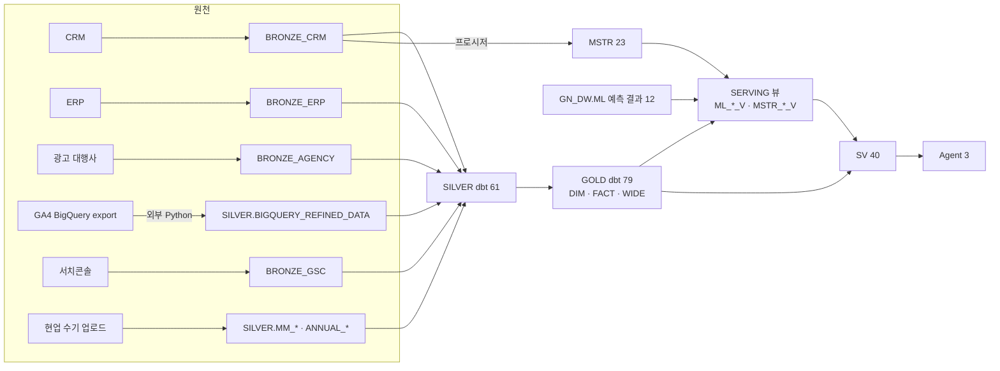

# D06. 원천 → 타깃 매핑 / 테이블 계보

본문 = `D06_테이블계보.csv`(2026-10-21 SR61467 재생성 = 659간선 · 열 = 간선 종류 · 상류 · 하류 · 근거). **테이블 단위**다. 컬럼 단위 계보는 이번 판에서 만들지 않았다(§4).

## 1. 간선 종류 (실측)

| 종류 | 간선 | 근거 | 범위 |
|---|---|---|---|
| dbt source | 76 | 모델 SQL 의 `source()` × `_sources.yml` | → SILVER 모델 71 · → GOLD 모델 5(`DIM_DATE` ← BRONZE_CRM 1 · `FACT_AD_PERFORMANCE`·WIDE 3 ← SILVER 외부 적재 4 · DR-25 → 🟡 2026-10-20 코드 수정: `DIM_DATE` ← `ref(SILVER.CRM_HOLIDAY)` · 배포 후 재생성하면 이 행이 SILVER 모델 72 · GOLD 4 로 바뀐다) |
| dbt ref | 284 | 모델 SQL 의 `ref()` | SILVER → SILVER · SILVER → GOLD · GOLD → GOLD |
| SV base | 108 | `SEMANTIC_TABLES` | GOLD·SERVING 뷰 → SV 논리테이블 |
| view dependency | 191 | `OBJECT_DEPENDENCIES`(🔴 ACCOUNT_USAGE 지연 · O250 신규 뷰 2종은 다음 재생성에 들어온다) | 뷰 → 테이블(GOLD WIDE · SERVING ML/MSTR 뷰 · MSTR 뷰) |

- 미해결 간선 0 · 물리 객체가 없는 dbt 모델 0(생성기 판정).
- dbt 모델 140 = SILVER 61 + GOLD 79. 모델 파일명 = 물리 테이블명이다.
- `bronze_crm` source 는 target 분기(`dev2` → `BRONZE_CRM_2`)가 있다. 이 계보는 기본 target(`BRONZE_CRM`) 기준이다.

## 2. 레이어 흐름

- MSTR 계열은 dbt 가 아니라 프로시저(`USP_RUN_MSTR_1ST`)로 BRONZE_CRM 을 직접 읽는다 ⇒ 프로시저 내부 계보(BRONZE → MSTR 테이블)는 이 csv 에 없다. MSTR 이 들어간 간선 50 은 MSTR 뷰·SERVING 뷰·SV 쪽 의존이다.
- ML 결과 12 테이블은 외부 ML 프로시저가 적재한다(이관 범위 = 결과 테이블만 · 08 §[4]). 테이블마다 하류 간선이 1개씩 있다(SERVING ML 뷰).

## 3. 계보 관찰 (실측)

| # | 관찰 | 대상 | 해석 |
|---|---|---|---|
| L-1 | dbt 로 만들지 않는 SILVER 5 | `AD_CREATIVE_CAMPAIGN_MAP` · `ANNUAL_DVLP_GOAL_ACMSLT_AGGR_DATA` · `ANNUAL_MBRFEE_PRDT_ACTL_DATA` · `BIGQUERY_REFINED_DATA` · `MM_SPNSR_CLS_AGGR_DATA` | 외부 적재·수기 업로드·매핑표(`silver_external` source + 매핑 적재 SQL) · SILVER 66 = dbt 61 + 이 5 |
| L-2 | 하류 소비가 없는 SILVER 6 | `CRM_CAMPAIGN_SPONSOR_BIZ_BRIDGE` · `CRM_MEMBER_CONVERT_HIST` · `CRM_MEMBER_RESPONSOR` · `CRM_MKTNG_CODE` · `CRM_SEND_MEMBER_LINK_LOG` · `CRM_SEND_MEMBER_OPEN_LOG` | 계보상 소비처 없음 — 매크로 직접 참조·향후 모델용일 수 있다 ⇒ `TBD(미검증)` |
| L-3 | 하류 소비가 없는 GOLD 19 | DIM 5(`DIM_CHILD` · `DIM_CODE_GROUP` · `DIM_MSG_TEMPLATE` · `DIM_MSG_TEMPLATE_BUTTON` · `DIM_PAYMENT_ACCOUNT`) · FACT 3(`FACT_PAYMENT_METHOD_CHANGE` · `FACT_RELATION_CHANGE` · `FACT_RELATION_DEV`) · WIDE 11(`WIDE_AD_BROADCAST` · `_CASE` · `WIDE_AD_DIGITAL` · `WIDE_AD_PERFORMANCE` · `WIDE_BIGQUERY_BEHAVIOR` · `WIDE_BUDGET` · `WIDE_EVENT_PARTICIPATION` · `WIDE_MEMBER_EVENT` · `WIDE_MEMBER_MONTHLY` · `WIDE_SERVICE_EVENT` · `WIDE_TARGET_DEV`) | SV·뷰·dbt 어디서도 읽지 않는다. WIDE 뷰는 BI·직접 조회용일 수 있다 ⇒ 사용 이력(ACCESS_HISTORY)으로 판정 필요 · `TBD(미검증)` |
| L-4 | 원천 BRONZE 중 계보 밖 5 | `SYNC_ERR_INFO`(AGENCY·ERP·GA4·GSC 4) · `BRONZE_GSC.SEARCH_CONSOLE_DATA2` | 이름으로 보아 적재 오류 로그·별도 적재본으로 보인다(내용 미확인 · `TBD(미검증)`) |
| L-5 | SERVING 뷰 19 전부 SV base | — | SV 없이 노출되는 SERVING 뷰 0 |

## 4. 한계 · 후속

- 컬럼 단위 계보: dbt 모델 SQL 파싱 또는 Snowflake `GET_LINEAGE`(컬럼 도메인)로 만들 수 있다. 이번 판에는 없다 ⇒ N03(통합 데이터 사전)에서 지표 → SV → GOLD 컬럼 축으로 보완한다.
- `OBJECT_DEPENDENCIES` 는 ACCOUNT_USAGE 지연(최대 3시간)이 있다. 뷰를 방금 바꿨다면 다음 날 다시 생성한다.
- 운영계 생성본과 비교해 간선 집합이 같아야 한다(구조 [공통]).

## 5. 드리프트

- 없음(이 문서는 라이브·파일에서 직접 생성했다). L-2·L-3 는 결함 판정이 아니라 관찰이다.
