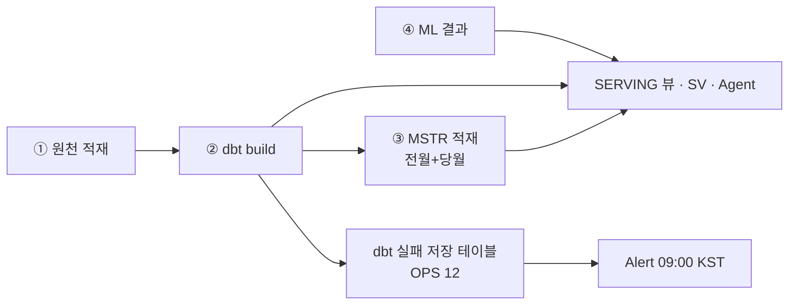

# D07. ETL / 파이프라인 설계서

## 1. 파이프라인 구성 (4 경로)

| 경로 | 엔진 | 실행 롤 · WH | 입력 → 출력 | 일정 |
|---|---|---|---|---|
| ① 원천 적재 | BRONZE 적재 프로시저 10(Python 7 · SQL 3) + Task 7 · CRM 은 원천 담당 | GN_DW_ADMIN(Task 소유) · LOADER | CRM·ERP·대행사·GSC·GA4 → BRONZE_* · GA4 → `SILVER.BIGQUERY_REFINED_DATA` · 수기 → `SILVER.MM_*`·`ANNUAL_*` | Task 01:10(대행사 3) · 01:20(GA4) · 01:30(GSC) · 01:40(BIGQUERY) KST · 최근 30일 각 성공 30 |
| ② dbt DW_PIPELINE | Snowflake DBT PROJECT(dbt 1.9.4) | GN_DW_DBT · ETL_WH | BRONZE·외부 SILVER → SILVER 61 → GOLD 79 | `"daily"` 06:01 KST · started · 최근 30일 성공 15 · 실패 5(마지막 실패 2026-10-13) |
| ③ MSTR 적재 | 저장 프로시저(SQL) | GN_DW_ADMIN · ETL_WH | BRONZE_CRM → MSTR 23(테이블 10 · 뷰 13) | `TSK_RUN_MSTR_DAILY` 07:30 KST · started · 최근 30일 성공 15 |
| ④ ML 예측 | ML 프로시저 23(데이터셋 적재·예측 22 + 시뮬레이터 1 · SQL) | — | 예측 결과 → `GN_DW.ML` 테이블 42 · 뷰 5 → SERVING ML 뷰 | 월마감(`SP_EXEC_MONTH_END`) |

- 운영계 = ZL50263 · 근거 = `_ENV/ZL50263/N04_Q01_1.csv`(Task) · `N04_Q05_1.csv`(실행 이력) · `B1_Q10_1.csv`(프로시저) · 2026-10-21 캡처.

## 2. dbt 설계 (② · 정본 = dbt_project.yml)

| 레이어 | 모델 | 전략 | pre-hook | 스키마 변경 |
|---|---|---|---|---|
| SILVER | 61 (crm 38 · bigquery 9 · agency 8 · erp 4 · bridge 2) | incremental + **append** + `full_refresh: false` | `silver_purge` — 전량 TRUNCATE · 범위 모델(`RANGED_MODELS`)은 창 DELETE | `append_new_columns` |
| GOLD dim | 28 | incremental(기본 merge · `unique_key`) + `full_refresh: false` | — | `append_new_columns` |
| GOLD fact | 32 | incremental + append + `full_refresh: false` | `gold_fact_purge` — 전량 TRUNCATE · 범위 팩트(`RANGED_FACTS`)는 창 DELETE | `append_new_columns` |
| GOLD wide | 19 | view(`gn_view_commented`) | — | `_wide_schema.yml` 이 COMMENT 정본 |

- 구조는 DDL 이 소유하고 dbt 는 데이터만 채운다(SILVER = `08_SILVER_테이블DDL` · GOLD 테이블 = `06_DDL.sql`).
- BIGQUERY 계열 = **롤링 윈도우 증분**(`bigquery_lookback_days: 3`). 재배포로 비면 창 밖이 자동으로 채워지지 않는다 ⇒ 재배포 후 일자 수 대조 필수(A6 Q04).
- 백필 = `EXECUTE DBT PROJECT … ARGS='build --select <모델>+ --vars ''{"bigquery_dt_ranges": [[…]]}'''`(A4 §5).
- 스냅샷 = 🔴 영구 미가동(DEC-61 · `+enabled: false` · `snapshots/` 11 파일은 기록용).
- dbt 테스트 실패 저장 = OPS(`store_failures` · 운영계 실패 저장·경고 테이블 13 = `ACCEPTED_VALUES_*` 2 · `NOT_NULL_*` 4 · `WARN_*` 7 · 2026-10-27 A6 Q03). 🆕 10-27 신규 = `NOT_NULL_WIDE_MBRFEE_PRDT_ACTL_DATA_TYPE_STD` 88행(11:11 test 실행분 · 원인 미분해). 🔴 원천 코드값 `')'` 로 실패 행 발생 이력(DR-24 · 운영계 현재 행 수는 A6 Q03 로 확인).

## 3. 프로시저 · 함수 (Q10 운영계 실측 · 주 스키마 62)

| 스키마 | 종류 | 이름 | 언어 | 역할 |
|---|---|---|---|---|
| BRONZE_* | 프로시저 10 | AGENCY `SP_LOAD_*` 4 · BIGQUERY `SP_LOAD_BIGQUERY`(Python)·`SP_LOAD_BIGQUERY_REFINED_DATA`(SQL) · ERP `SP_LOAD_BUDGET_BY_YEAR`·`SP_LOAD_EXPENSE_RESOLUTION_BY_YEAR` · GA4 `SP_LOAD_GA_USER_DEMOGRAPHIC` · GSC `SP_LOAD_GOOGLE_SEARCH` | Python 7 · SQL 3 | 원천 적재(①) |
| BRONZE_CRM | 프로시저 1 | `SP_EXEC_MONTH_END` | SQL | 월마감(④ 선행) |
| SILVER | 프로시저 8 | `SP_INSERT_MM_SPNSR_CLS_AGGR_DATA1~5` · `SP_ANNUAL_DVLP_GOAL_ACMSLT_AGGR_DATA1·2` · `SP_INSERT_ANNUAL_MBRFEE_PRDT_ACTL_DATA` | SQL | 수기·연간 집계 적재 |
| MSTR | 프로시저 13 | `USP_RUN_MSTR_1ST` (오케스트레이션) · `USP_D_*` 7(차원) · `USP_F_MM_SPNSR_DVLP` · `_SUM` · `_SUM_INIT`(🔴 전체 초기화 · 일 배치 금지) · `USP_BCHLOG` · `USP_BCHERR` | SQL | MSTR 적재(③) |
| MSTR | 함수 2 | `FN_MM_ACT_DATE` · `FN_MM_SPNSR_DVLP` | SQL | 기준월 활동회원 · 개발실적 |
| OPS | 프로시저 5 | `USP_SYNC_ALERT_RECIPIENTS` · `USP_SEND_PIPELINE_ERROR_ALERT` · `SAMPLE_ETL_PIPELINE_PROC` · `SEND_EMAIL_ON_ERROR_SAMPLE`(Python · 예시) · `USP_SEND_DBT_WARN_SPNSR_CLS_DUP`(SQL) | Python 4 · SQL 1 | 알림(수신자 동기화 · 공통 발송 · 예시 2 · dbt 경고) |
| ML | 프로시저 23 | `SP_INSERT_ML_DATASET_*` 10 · 예측·기여도 `SP_*_PREDICT`·`SP_*_FORECAST`·`SP_*_CONTRIBUTION` 등 12 · `SP_SIMULATE_CAMPAIGN_DVLP` | SQL | 데이터셋 적재 · 예측(④) · 광고비 변동 시뮬레이션(SV_ML_REALTIME_SIMULATOR 와 짝) |

- 소유 = GN_DW_ADMIN 69 · ACCOUNTADMIN 1(`OPS.SEND_EMAIL_ON_ERROR_SAMPLE`).
- 백업 사본 스키마 `SILVER_2` 의 프로시저 8 은 위 표에서 뺐다(운영 경로 아님).

## 4. 스케줄 · 알림 [ENV]

| 객체 | 운영계(ZL50263 · 2026-10-21) |
|---|---|
| dbt 일배치 Task | `GN_DW.OPS."daily"` 06:01 KST · started · 소유 GN_DW_DBT |
| MSTR 일 적재 Task | `GN_DW.MSTR.TSK_RUN_MSTR_DAILY` 07:30 KST · started · 소유 GN_DW_ADMIN |
| 원천 적재 Task 7 | `BRONZE_AGENCY.AGENCY_TASK_MASTER`(01:10) → `TASK_DGT`·`TASK_REBRDC`·`TASK_VIDEO` · `BRONZE_GA4.TASK_GA_USER_DEMOGRAPHIC`(01:20) · `BRONZE_GSC.TASK_GOOGLE_SEARCH`(01:30) · `BRONZE_BIGQUERY.TASK_LOAD_BIGQUERY`(01:40) · 전부 started |
| dbt 경고 Alert | `OPS.ALERT_DBT_WARN_SPNSR_CLS_DUP` 09:00 KST · started · WH GN_DW_ETL_WH |

- MSTR Task 는 dbt Task 와 DAG 로 묶이지 않는다(다른 스키마·소유 롤) ⇒ 고정 시각 운영. dbt 가 07:30 을 넘기면 두 기준이 다른 BRONZE 를 볼 수 있다.

## 5. 운영 · 장애

- 배포·실행·백필 절차 = A4 §4~§5. 장애 유형 9종(F1~F9)·재처리 원칙 = A6 §3~§4. 정기 점검 = A7.

## 6. 드리프트

| # | 문서 기재 | 실측 | 처리 |
|---|---|---|---|
| DR-01 | Step 4 일일 DAG(snapshot → build) · `TASK_DBT_DAILY_DEV2` | 미배포 · 루트 snapshot 은 DEC-61 과 충돌 · dev2 는 테스트용 | 운영계 `"daily"` Task 가 정본(결정) |
| DR-19 | 01_deploy · 03_일배치「실행 롤 = ENGINEER」 | 실행 롤 = GN_DW_DBT | 기록만 |
| DR-21 | 운영계 Task 2종 기재 | `"daily"` · `TSK_RUN_MSTR_DAILY` 실재 · started(2026-10-21) | 해소(운영계 확인) |
| DR-24 | dbt 경고 감시 = 1종 | 운영계 OPS 실패 저장·경고 테이블 13종(10-27) | A6 Q03 동적화 · 원천 정정 요청 |
| — | dbt README「65 models」 | 140 models | 기록만 |
