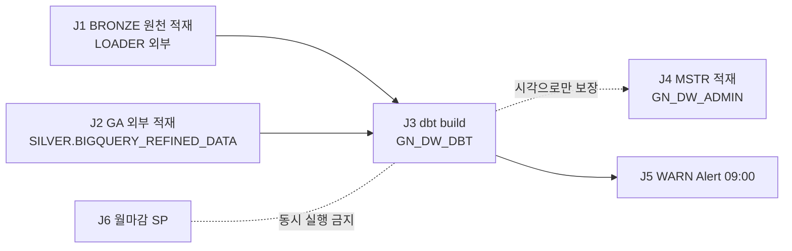

# N04. 배치 SLA · 스케줄 정의서

본문 = `N04_배치SLA_스케줄.csv`(작업 6행 · 롤 · WH · 개발계/운영계 스케줄 · 선행 · 평균/최대 소요 · 실패 시 담당 · 재처리).

## 1. [공통] 일 단위 순서

- J4 를 J3 의 `AFTER` 로 걸 수 없다(DAG 는 같은 스키마·같은 소유 롤 · MSTR 07 :13~15) ⇒ 운영계는 고정 시각 07:30 이다.

## 2. [ENV] 실측 (IW20760 및 운영계 ZL50263)

| 항목 | 개발계(IW20760) | 운영계(ZL50263) | 근거 |
|---|---|---|---|
| GN_DW Task | 0 | 9개 (`daily`, `TSK_RUN_MSTR_DAILY`, `AGENCY_*` 등 9개 전체 STARTED) | Q01 |
| 최근 30일 Task 실행 | 24건 전부 `AI_EVALS_*`(SERVING · 시스템 생성) — 배치 아님 | `AGENCY_*` 태스크 일일 실행 중 (13건 SUCCEEDED) | Q05 |
| dbt build | 4회 전부 SUCCESS · 전체 build 1회 **610초**(Small) · 부분 build 34·36·138초 | 전체 build 585~610초 (SUCCESS) · 부분 build 15~46초 | Q03·Q04 |
| dbt compile/parse | ADMIN compile 4(평균 40초) · DBT compile 1(27초) · parse 1(15초) | parse, compile, build 다수 SUCCESS 기록 | Q03 |
| MSTR 적재 | 34개월 일괄 1,126초 · 월 1회분 **평균 33초 · 최대 72초**(33 순환) · 오류 0 | 151개 월 순환 집계 (평균 9,668초 · 최대 193,933초) | Q07 |
| WARN Alert | 매일 09:00 KST · 6~7초 · 최근 2회 CONDITION_FALSE | 매일 09:00 KST · 6~9초 · 최근 CONDITION_FALSE 정상 | Q02·Q06 |

- 🔴 MSTR `BCHLOG.RUNKEY` 가 510행 전부 NULL 이다 ⇒ 실행 단위 소요를 직접 셀 수 없어 「월마다 1행 남는 `USP_D_STRD_CAL_CD` 간격」으로 월 1회분을 쟀다(Q07 주석). 운영 일 1회분은 전월+당월 2개월이므로 약 2배다(추정 · 실측 아님).
- 🟠 BRONZE `LAST_ALTERED`(Q08)는 2026-10-17 재구축 시각이다 — DDL·GRANT 로도 바뀌므로 적재 시각으로 인용하지 않는다. 적재 신선도는 A6 Q09(`_LOAD_DT`)를 쓴다.

## 3. [공통] SLA (🟡 제안 — 사용자·현업 확정 전)

| 작업 | 목표 | 판정 | 근거 |
|---|---|---|---|
| J1 원천 적재 | 06:00 KST 전 완료 · `_LOAD_DT` 24시간 이내 | A6 Q09 `HOURS_STALE ≤ 24` | RUNBOOK §1.3·§4.1 |
| J3 dbt build | 07:30 KST 전 완료(J4 시작 전) · ERROR 0 · SKIP 0 | A6 Q01 · Q03 0행 | 운영계 06:01 시작 + 전체 610초 ⇒ 약 80분 여유(개발계 Small 기준 · 운영계 데이터량 차이 TBD) |
| J4 MSTR | 08:00 KST 전 완료 · `BCHLOG` 오류 0 | A6 Q06 | 월 1회분 최대 72초 × 2개월 |
| J5 Alert | 09:00 실행 · 실패 0 | A6 Q05 | — |

- 목표 시각은 운영계 Task 시각(06:01·07:30·09:00)에서 역산한 **제안**이다. 확정 전에는 TBD 로 둔다.
- 운영계 데이터량이 다르면(작업계획 전제: `BIGQUERY_REFINED_DATA` 적재 범위만 다름) J3 의 GA 체인 소요가 달라진다 ⇒ 운영계 Q04 로 재측정한다.

## 4. 실패 시

| 작업 | 1차 담당 | 처치 |
|---|---|---|
| J1·J2 | LOADER 팀 · GA 적재 담당 | 재적재 요청 → J3 재실행 · GA 는 백필(A4 §5) |
| J3 | DW 관리자(GN_DW_DBT) | A6 F1 → `ARGS='retry'` |
| J4 | DW 관리자(GN_DW_ADMIN) | A6 F5 → 해당 월만 재 CALL |
| J5 | DW 관리자 | A6 F3·F4 |
| 에스컬레이션 | — | RUNBOOK §9: L1 ENGINEER 15분 → L2 ADMIN 30분 → L3 ACCOUNTADMIN+Support 1시간(A6 §6) · 담당자 이름은 TBD |

## 5. 드리프트

| # | 문서 기재 | 실측 | 처리 |
|---|---|---|---|
| DR-21 | 운영계 dbt Task `"daily"` 06:01 · MSTR Task 07:30 | 개발계 둘 다 없음 | 운영계에서 Q01 로 확인 |
| (신규 없음) | — | `BCHLOG.RUNKEY` 전부 NULL 은 관찰 사항이다(로그 설계 · 운영계 동일 여부 TBD) | 기록만 |
