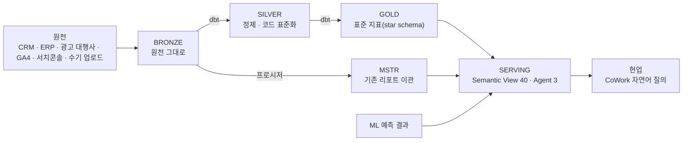

# N08. 사업 완료 보고서

## 1. 목적

굿네이버스의 CRM · ERP · 광고 · 웹(GA) 데이터를 Snowflake 한 곳(GN_DW)에 모아 **부서마다 다르던 지표를 한 가지 정의로 맞추고**,
현업이 **자연어로 질문해 답을 얻을 수 있게** 하는 것.

## 2. 아키텍처 (한 장)

- 계층은 한 방향으로만 참조한다(SERVING → GOLD → SILVER → BRONZE). 권한은 7개 역할로 나눴다(소유 · 개발 · 적재 · 변환 · 분석 · 조회 · 서비스).

## 3. 구축 규모

**운영계 (ZL50263 · 2026-10-27 실측)**
| 계층 | 테이블 | 뷰 | 행 |
|---|---|---|---|
| BRONZE(원천) | 1,122 | 0 | 793,945,828 |
| SILVER(정제) | 76 | 1 | 1,158,748,488 |
| GOLD(표준 지표) | 64 | 19 | 276,422,355 |
| ML(예측 결과) | 39 | 5 | 443,541,172 |
| MSTR(기존 리포트) | 10 | 13 | 1,891,979 |
| SERVING(소비) | 1 | 25 | 2,156 |

| 소비 수단 | 개수 |
|---|---|
| Semantic View | 45(실적 28 · 예측 16 · MSTR 1) |
| Cortex Agent | 3(회원 · 마케팅 · 경영 · 계정 내 전체 6) |
| Streamlit 앱 | 9(LAB 스키마) |

## 4. 성과

| 영역 | 이전 | 지금 |
|---|---|---|
| 지표 정의 | 부서·보고서마다 다름 | GOLD 표준 지표 + SV 정의 1곳 · 「조용히 틀리는 지표」 6종을 문서·Agent 규칙으로 막음(D12 §3) |
| 조회 방식 | 엑셀 · 수작업 집계 | Agent 3종에 자연어 질문 · 분석가는 SV 로 직접 조회 |
| 기존 리포트 | MicroStrategy | MSTR 스키마로 이관 · 같은 원천 기준으로 재현 |
| 예측 | 없음 | 이탈 위험 · 회비 · 개발 예측을 실적과 같은 화면에서(추정치 표기) |
| 운영 | 문서 흩어짐 | 실무자 인수인계 9종 · 정식 산출물 22종 · 계정 값 분리(운영계 값 별도 관리) |

## 5. 남은 과제 (운영 이관 전 · P1)

1. 잔여 변경분을 운영계에 한 번에 반영(A8-01~03).
2. 분석가 역할의 CoCo 사용 차단 — 운영계에서 시험 후 결정(A8-04).
3. Agent 최신 버전 스모크 시험(A8-05).
4. 원천(BRONZE) 개인정보 12개 컬럼 마스킹 적용 — 결정 완료 · 실행 대기(A8-28).
5. ~~장애 알림 경로 연결~~ — 🟢 2026-10-27 해소(09 §7 `ALERT_DAILY_TASK_FAILED` · A8-10).

- 그 밖의 미결 = A8 29건(P1 6 · P2 8 · P3 15) · 현업 회신 대기 · 원천 입고 대기는 D13 §2.
- 비용은 실측 기간(2일)이 짧아 월 추정을 확정하지 못했다 — 운영 4주 후 재산정(N06).

## 6. 운영 체계

| 무엇 | 누가 | 문서 |
|---|---|---|
| 매일 점검 · 장애 대응 | 데이터 엔지니어 → DW 관리자 → Snowflake Support | D10 · A6 |
| 배치 스케줄 | 운영계 dbt 06:01 · MSTR 07:30 · 경고 메일 09:00(KST · 운영계 확인 필요) | N04 |
| 권한 · 사용자 | DW 관리자 | A1 · A2 |
| 비용 | DW 관리자(주 1회) | D11 · N06 |
| 현업 문의 | DW 관리자 | D12 |

_Co-authored with CoCo_
